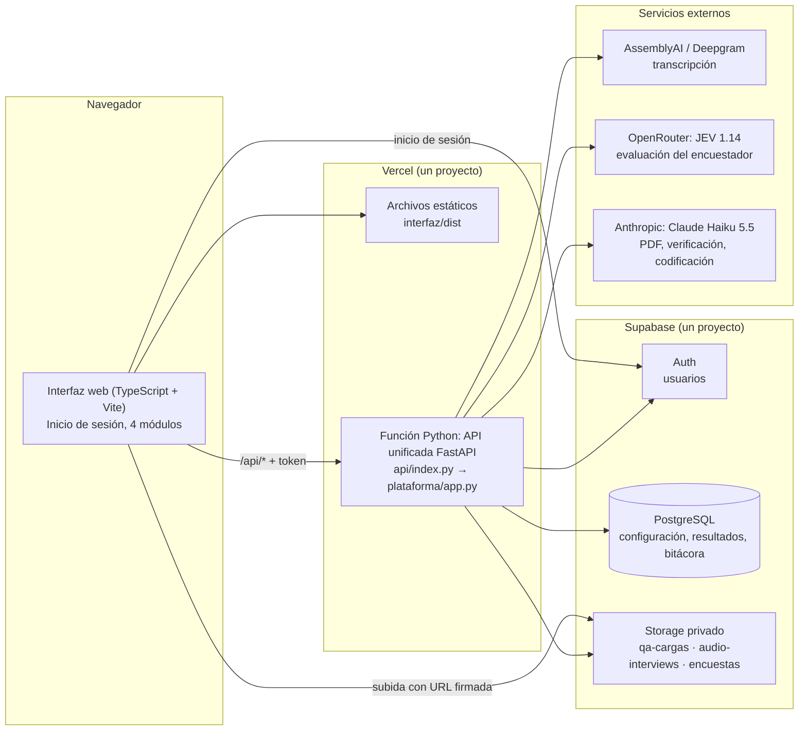

# Quality Audit

**Plataforma de aseguramiento de la calidad estadística** · Equipo **Data Engineers** · **Datatón INE Guatemala 2026**

| | |
|---|---|
| Sistema en línea | https://dataton-six.vercel.app (acceso con cuenta; ver [Accesos](documentation/accesos.md)) |
| Guía para el jurado | [Cómo evaluar Quality Audit en 30 minutos](documentation/guia-jurado.md) |
| Repositorio | https://github.com/destor01/Data_Engineers_Datat-n2026 |
| Link del Video | https://drive.google.com/file/d/1uC7-kpgokHQxdtCTBuPJ0xqsMBXRoqqF/view?usp=sharing |

---

## Resumen ejecutivo

Quality Audit revisa la calidad de la información estadística en sus dos orígenes: los **registros administrativos** que las instituciones envían al INE y las **entrevistas de encuestas** que el INE levanta en campo. En una sola plataforma web:

- **Data Audit** valida cada base institucional contra su diccionario oficial, la corrige sin cambiar su significado, propone códigos para lo que no coincide y guarda cada decisión. Con los crudos reales de 2025-2026 procesó cinco bases en 1 a 7 segundos cada una. En defunciones conservó **exactamente los mismos 8,841 registros** que publicó el INE.
- **Audio Audit** transcribe la grabación de una entrevista, separa a los hablantes y evalúa, con un modelo de decisión, si el encuestador cumplió las **51 reglas** del Manual del Encuestador ENCOVI 2023. Muestra la evidencia con el minuto exacto de la grabación.
- **Survey Audit** convierte el **cuestionario en PDF de cualquier encuesta** en un formulario digital con secciones, códigos, opciones y pases. Valida las respuestas y las compara con lo que se escucha en la grabación.
- **Quality Improvement** convierte los hallazgos en **recomendaciones específicas por institución, regla y período**, con su evidencia. Los resume en un **manual institucional en PDF** aprobado por un responsable.

El valor institucional está en que cada problema queda **detectado, explicado, corregido o devuelto con evidencia, y trazado**. Lo que se aprueba una vez se aplica solo en los envíos siguientes. La revisión humana sigue siendo la que decide: el sistema propone y documenta.

## Problemática

El INE recibe y produce datos con problemas que hoy se resuelven con trabajo manual:

1. **Registros administrativos heterogéneos.** Cada institución envía su base a su manera: nombres de columna distintos, texto donde va un código («MASCULINO» en lugar de 1), marcas de «sin dato» («N.D.», «-1»), hojas con encabezados combinados y texto libre que se codifica a mano (causas de muerte, motivos de detención). La revisión depende de sintaxis por base y deja poca trazabilidad de qué se cambió y por qué.
2. **Supervisión de campo costosa.** Verificar si un encuestador leyó las preguntas, se presentó correctamente o no indujo respuestas exige escuchar horas de grabación. En la práctica solo se revisa una muestra pequeña.
3. **Cuestionarios en papel o PDF.** Pasar un cuestionario como ENCOVI (72 páginas, tablas, pases condicionales) a un instrumento digital validable es lento y propenso a errores.
4. **Retroalimentación débil a las fuentes.** Los mismos errores se repiten mes a mes porque la institución no recibe un diagnóstico concreto, con evidencia y acciones.

## Objetivo general

Proveer al INE una plataforma que asegure de forma integral la calidad de la información estadística, desde la recepción de los registros administrativos y la recolección en campo hasta la retroalimentación a las instituciones, con trazabilidad completa y respeto al secreto estadístico.

## Objetivos específicos

| Módulo | Objetivo específico |
|---|---|
| Data Audit | Validar automáticamente las bases institucionales en 7 dimensiones de calidad, corregir lo seguro, proponer códigos para lo dudoso y conservar cada decisión para aplicarla en envíos futuros. |
| Audio Audit | Transcribir las entrevistas, identificar al encuestador y estimar con probabilidades el cumplimiento de cada regla del manual, con evidencia temporal y calibración a partir de las correcciones del supervisor. |
| Survey Audit | Generar el formulario digital directamente del cuestionario en PDF, validar las respuestas y contrastarlas con la grabación (coincidencia, discrepancia o no verificable). |
| Quality Improvement | Transformar los hallazgos en recomendaciones específicas por institución, regla y período, aprobadas por un responsable y entregadas como manual institucional en PDF. |

## Propuesta de valor

- **Integral:** cubre registros administrativos y encuestas en un mismo sistema, con un mismo inicio de sesión, almacenamiento y trazabilidad.
- **Aprende de cada revisión:** una corrección aprobada se guarda como equivalencia de la institución y se aplica sola en la siguiente carga. Las ediciones del supervisor en Audio Audit **calibran** las probabilidades del modelo.
- **Configurable sin programar:** una base nueva se agrega con un archivo YAML. Los umbrales de cada regla se cambian en la base de datos. Las reglas de JEV se reescriben desde la pantalla.
- **Explicable:** cada hallazgo trae filas, columnas, porcentajes o el minuto de la grabación. No hay puntajes sin evidencia.
- **Funciona con cualquier encuesta:** Survey Audit no depende de ENCOVI; lee el PDF que se suba.
- **Bajo costo:** software libre y servicios en planes gratuitos. El gasto variable por uso de IA es de centavos por base y de 1.04 USD por cuestionario convertido en formulario (ver [costos](documentation/ia-y-servicios.md#costos)).
- **Pensado para personas no programadoras:** textos y mensajes en lenguaje claro, sin códigos HTTP ni términos técnicos.

## Funcionalidades y estado real

| Módulo | Qué hace | Estado |
|---|---|---|
| **Data Audit** | Lee XLSX/XLS/CSV en tres formatos (tabla, hojas mensuales y formato ancho) y ubica el encabezado solo. Aplica 33 reglas en 7 dimensiones con puntaje de 0 a 100, corrige lo seguro, excluye lo que no debe publicarse y elimina datos personales. Bandeja para aprobar, corregir o rechazar sugerencias, con búsqueda en catálogos. Reproceso con lo aprobado, decisión técnica, historial de bases subidas y correcciones guardadas por institución. Descargas: base corregida, bitácora y reporte. 5 bases configuradas (RENAP, PNC, INSIVUMEH y SECONRED). | Funcional y desplegado. Validado con crudos reales. |
| **Audio Audit** | Transcribe en la nube (AssemblyAI) y separa hablantes. Asigna roles y evalúa con JEV las 51 reglas ENCOVI A1–A2. Reporte con veredicto, cumplimiento global y por sección, conducta por hora, riesgos y minuto exacto. Edición de cada evaluación, reescritura de criterios, calibración, historial y descarga JSON para Survey Audit. | Funcional y desplegado. Evaluación probada con transcripción sintética. Falta medir la precisión con grabaciones reales. |
| **Survey Audit** | Lee el cuestionario en PDF con IA, por bloques de páginas, incluidas las tablas grandes. Editor para revisar preguntas, códigos, opciones y pases. Entrevistas con código único, captura con secciones por persona y saltos, y validación al finalizar. Vínculo de la transcripción con consentimiento. Verificación pregunta por pregunta con evidencia temporal y revisión humana. | Funcional y desplegado. ENCOVI 2023 en prueba con el PDF real. |
| **Quality Improvement** | Importa el reporte de Data Audit y agrupa por institución, base, período y regla. Genera recomendaciones específicas (qué ocurrió, por qué importa, cómo corregir, cómo prevenir y acciones) con evidencia. Edición, aprobación con cargo y manual institucional editable en PDF. | Funcional y desplegado. |

## Arquitectura



Una sola API sirve a los cuatro módulos: `/api/qa/*` (Data Audit), `/api/jobs`, `/api/rules` y `/api/calibration` (Audio Audit), `/api/surveys/*` (Survey Audit) y `/api/improvement/*` (Quality Improvement). Toda ruta exige una sesión válida de Supabase Auth. Los archivos grandes van del navegador directo al almacenamiento privado con URLs firmadas. La arquitectura lógica y física, los flujos, el modelo de datos y las decisiones de diseño están en [Arquitectura](documentation/architecture.md).

## Tecnologías

| Capa | Tecnología | Versión probada |
|---|---|---|
| Interfaz | TypeScript, Vite, supabase-js | TypeScript 5.9.3, Vite 6.4.6, supabase-js 2.119.2 |
| API | Python, FastAPI, Uvicorn, Pydantic | Python 3.12 (Vercel) y 3.13 (pruebas), FastAPI 0.165, Pydantic 2.14 |
| Datos | pandas, python-calamine, openpyxl, XlsxWriter, RapidFuzz, PyYAML | pandas 3.1, RapidFuzz 3.14 |
| Base de datos | PostgreSQL (Supabase), psycopg 3 | PostgreSQL 16, psycopg 3.3 |
| Documentos | pypdf, fpdf2 (con fuentes DejaVu) | pypdf 7.1, fpdf2 2.9 |
| IA | Claude Haiku 5.5 (Anthropic), JEV 1.14 (TypeSafe vía OpenRouter) | Modelos fijados por versión |
| Voz | AssemblyAI, Deepgram Nova-3; local: WhisperX, Pyannote community-1, PyTorch, FFmpeg | WhisperX 3.8, pyannote.audio 4.1 |
| Infraestructura | Vercel (Hobby), Supabase (plan gratuito), GitHub | — |
| Pruebas | pytest, Playwright (navegador) | pytest 9.2, Playwright 1.65 |

Lista completa de dependencias y sus licencias: [Licencias de terceros](documentation/licencias.md).

## Instalación rápida

**Opción A: usar el sistema publicado.** Entrar a https://dataton-six.vercel.app con la cuenta entregada al jurado. No requiere instalar nada.

**Opción B: ejecutar todo en local** (Windows o Linux; Python 3.12+, Node.js 22, PostgreSQL 16). Desde la raíz del repositorio:

```bash
python -m venv .venv
# Windows: .venv\Scripts\activate      Linux/macOS: source .venv/bin/activate
pip install -r requirements.txt
cp .env.example .env                  # completar DATABASE_URL y, opcionalmente, las llaves de IA
psql "$DATABASE_URL" -f data-audit/qa_bases_datos/schema.sql
psql "$DATABASE_URL" -f interfaz/backend/migrations/001_extensions.sql
cd data-audit/qa_bases_datos/backend
python -m scripts.cargar_config --dicc-defunciones <ruta> --dicc-nacimientos <ruta> --dicc-pnc <ruta>
cd ../../..
uvicorn api.index:app --port 8000     # API
cd interfaz && npm ci && npm run dev  # interfaz en otra terminal (VITE_APP_MODE=api)
```

Los pasos completos están en [Instalación y reproducibilidad](documentation/installation.md): requisitos de hardware, versiones exactas, variables, base de datos, verificación y solución de problemas. La publicación en Vercel y Supabase está en [Despliegue](documentation/deployment.md).

## Demostración

1. **Sistema:** https://dataton-six.vercel.app.
2. **Recorrido sugerido para el jurado:** [guía de evaluación](documentation/guia-jurado.md). Incluye un camino sin datos sensibles: archivos sintéticos para los cuatro módulos en `documentation/ejemplos/` (entrevista ENCOVI, CSV de emergencias, cuestionario y transcripción).

## Resultados

| Indicador | Resultado | Fuente |
|---|---|---|
| Bases institucionales procesadas con crudos reales | 5 bases y 218,159 registros de entrada | [Pruebas](documentation/testing.md#resultados-con-crudos-reales) |
| Tiempo de validación por base | 1 a 7 segundos | Ídem |
| Puntaje de calidad por base | 88.8 (aire) a 98.0 (detenidos) | Ídem |
| Coincidencia con la base procesada por el INE (defunciones jul-2026) | 8,841 de 8,841 registros conservados, comparados uno por uno | [Metodología](documentation/methodology.md#validación-contra-lo-publicado-por-el-ine) |
| Coincidencia con la regla de representatividad de calidad del aire 2025 | 11 de 19 combinaciones idénticas; las 8 restantes difieren en un mes y se explican | Ídem |
| Codificación de texto libre con IA (muestra de prueba) | 19 de 20 aciertos; el texto ambiguo quedó sin código, sin adivinar | Ídem |
| Reglas del manual ENCOVI evaluadas por entrevista | 51 (24 de la sección A1, 27 de la A2) | [Metodología](documentation/methodology.md#audio-audit-evaluación-del-encuestador-con-jev) |
| Pruebas automáticas | 40 pruebas automáticas y 6 recorridos completos en navegador, todos aprobados; instalación limpia verificada | [Pruebas](documentation/testing.md) |
| Costo de IA | 1.04 USD por cuestionario para generar el formulario (medido con la ENCOVI 2023, 72 páginas); ~0.32 USD la primera carga de defunciones y <0.02 USD una de PNC (estimado) | [IA y servicios](documentation/ia-y-servicios.md#costos) |

## Datos y fuentes

- **Crudos institucionales** entregados por el INE para el Datatón (paquete «Conjunto de datos_ instituciones», 23-nov-2026): detenidos PNC (oct-2026), calidad del aire INSIVUMEH (2025), defunciones RENAP (jul-2026), emergencias SECONRED (2025) y nacimientos RENAP (jun-2026).
- **Publicaciones y diccionarios oficiales del INE**, compartidos con los equipos por correo electrónico por un miembro de la organización del Datatón el 24 y 25-nov-2026: diccionarios de defunciones y nacimientos 2018-2022, diccionario de detenidos PNC, bases publicadas de defunciones 2025, nacimientos 2022 y 2025, detenidos, monitoreo del aire 2025 y eventos CONRED 2022.
- **Cuestionario ENCOVI 2023** (PDF, 72 páginas) y **Manual del Encuestador ENCOVI 2023**, fuente de las 51 reglas de Audio Audit.

Ningún dato real está en el repositorio. Detalle, fechas y condiciones de uso: [Fuentes de datos](documentation/data-sources.md).

## Seguridad y secreto estadístico

- Inicio de sesión obligatorio (Supabase Auth), sin registro público. Toda ruta de la API verifica la sesión.
- Archivos en almacenamiento **privado**, accesibles solo con URLs firmadas de 5 minutos. **RLS** activado en todas las tablas.
- Data Audit **elimina las columnas personales** del archivo corregido (34 en defunciones y 17 en PNC) y **no guarda registros individuales** en la base de datos: solo metadatos, hallazgos y bitácora.
- A la IA solo se envían **textos distintos de una columna**, sin filas, nombres, CUI ni fechas, y con las cifras largas enmascaradas.
- Vincular una grabación exige confirmar la autorización de uso. La descarga del archivo original queda registrada.
- Las llaves solo existen como variables secretas del servidor, nunca en el repositorio.

Detalle, riesgos y mitigaciones: [Seguridad y confidencialidad](documentation/security.md).

## Limitaciones

- La precisión de la transcripción (WER), de la separación de hablantes (DER) y de la evaluación JEV **no se ha medido con grabaciones reales** de ENCOVI. Solo se probó con una transcripción sintética con errores sembrados.
- La codificación con IA se probó con 20 textos. Falta una muestra ya codificada por el INE para medir aciertos por catálogo. La causa de muerte se codifica desde la causa A, no la causa básica completa de la OMS.
- Los diccionarios oficiales son de 2018-2022. Calidad del aire y emergencias no tienen diccionario: sus catálogos se armaron desde las bases publicadas.
- Infraestructura de plan gratuito: archivos de hasta 50 MB y 300 segundos por petición. Una evaluación JEV de una entrevista muy larga podría superar ese tiempo.
- Survey Audit lee el PDF con IA: el formulario **debe revisarse** antes de usarse, sobre todo en tablas complejas.
- Todas las cuentas tienen el mismo permiso. Falta separar los roles de institución, analista y supervisor.
- Depende de servicios externos (Anthropic, OpenRouter, AssemblyAI) para la IA y la transcripción en la nube. Existe la alternativa local (WhisperX y Ollama), pero no se probó con datos reales.

## Posibles mejoras

| Mejora | Beneficio |
|---|---|
| Roles y permisos (institución, analista, supervisor, administrador) | Uso real por las instituciones, cada una solo con sus bases |
| Medición de precisión con muestras del INE (WER, DER, aciertos de JEV y de codificación) | Saber cuánto confiar en cada resultado automático |
| Causa básica de defunción con la cadena completa A→D (reglas OMS) | Codificación comparable con la del INE |
| Procesamiento en cola para archivos y entrevistas largas | Sin límite de 300 s ni de 50 MB |
| Tablero histórico de calidad por institución | Ver si la calidad de cada fuente mejora mes a mes |
| Aprobación masiva de sugerencias con confianza alta | Menos trabajo para el analista |
| Despliegue en infraestructura del INE con modelos locales | Ningún dato sale de la institución |
| Portal para que las instituciones validen antes de enviar | Menos errores desde el origen |

## Documentación

| Documento | Contenido |
|---|---|
| [Guía para el jurado](documentation/guia-jurado.md) | Recorrido de evaluación paso a paso |
| [Manual de usuario](documentation/user-guide.md) | Uso de los cuatro módulos, para personas no programadoras |
| [Arquitectura](documentation/architecture.md) | Arquitectura lógica y física, flujos, integración, modelo de datos y decisiones de diseño |
| [Instalación y reproducibilidad](documentation/installation.md) | Requisitos, versiones, configuración, base de datos, ejecución, verificación y problemas frecuentes |
| [Despliegue](documentation/deployment.md) | Publicación en Vercel y Supabase |
| [Metodología y rigor estadístico](documentation/methodology.md) | Fórmulas, umbrales, validación contra el INE y calibración |
| [Pruebas y resultados](documentation/testing.md) | Resultados cuantitativos y cómo reproducir las pruebas |
| [Fuentes de datos](documentation/data-sources.md) | Bases, diccionarios, fechas y condiciones de uso |
| [Seguridad y confidencialidad](documentation/security.md) | Secreto estadístico, controles y riesgos |
| [IA, servicios de pago y nube](documentation/ia-y-servicios.md) | Declaración de uso de IA generativa, servicios y costos |
| [Licencias de terceros](documentation/licencias.md) | Licencias de librerías, modelos, fuentes y servicios |
| [Historial de desarrollo y equipo](documentation/historial.md) | Ramas, integraciones, commits y contribuciones |
| [Aplicabilidad institucional](documentation/aplicabilidad-institucional.md) | Beneficiarios, integración con procesos del INE, recursos, beneficios medidos y potenciales, fases de escalamiento |
| [Innovación y diferenciación](documentation/innovacion.md) | Ciclo integrado de calidad, diferenciadores y aporte de la IA |
| [Limitaciones](documentation/limitaciones.md) | Impacto, mitigación actual y solución futura; funciones no implementadas |
| [Modelo de datos](documentation/modelo-datos.md) | Qué vive en PostgreSQL, en archivos y en memoria; diagramas entidad-relación ([tablas y columnas](documentation/modelo-datos-tablas.md)) |
| [Diccionario de datos](documentation/diccionario-datos.md) | Variables de cada base, tipos, valores permitidos, transformaciones y reglas |
| [Referencia de la API](documentation/api-referencia.md) | Las 78 operaciones con parámetros, respuestas y errores ([convenciones](documentation/integration-api.md)) |
| [Ejemplos sintéticos](documentation/ejemplos/) | Archivos para probar cada módulo sin datos reales |
| [Accesos](documentation/accesos.md) | Cuentas para entrar a la plataforma |

Documentación técnica detallada por módulo: [Data Audit](data-audit/qa_bases_datos/DOCUMENTACION.md), [Audio Audit](audio-audit/README.md), [Guía de reglas JEV](audio-audit/encovi_jev/GUIDE_JEV_QUESTIONS.md), [Survey Audit](survey-audit/README.md) y [Quality Improvement](quality-improvement/README.md).

## Equipo

**Data Engineers**

| Integrante | GitHub | Contribuciones principales (según el historial de Git) |
|---|---|---|
| Derek Tórtola | [destor01](https://github.com/destor01) | Motor y API de Data Audit, codificador con IA, integración de los módulos en una sola plataforma, despliegue en Vercel y Supabase con inicio de sesión, Survey Audit desde PDF, Quality Improvement, documentación |
| Guillermo Martínez | [guillermo-martinez42](https://github.com/guillermo-martinez42) | Audio Audit: transcripción, separación de hablantes en la nube, evaluación JEV, edición y calibración de evaluaciones, seguridad de la API de audio |
| Jennifer Morales | [jennn-xs](https://github.com/jennn-xs) | Organización de los módulos, interfaz común de Quality Audit, conexión de la interfaz con Audio y Data Audit, documentación técnica, integración de ramas |

Detalle por commit: [Historial de desarrollo](documentation/historial.md).

## Licencia

El código propio se entrega bajo los términos de la Nota Conceptual del Datatón: licencia institucional no exclusiva, gratuita, perpetua e irrevocable a favor del INE, conservando la autoría del equipo. Las librerías y modelos de terceros conservan sus licencias originales ([Licencias de terceros](documentation/licencias.md)).
