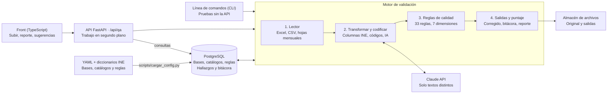
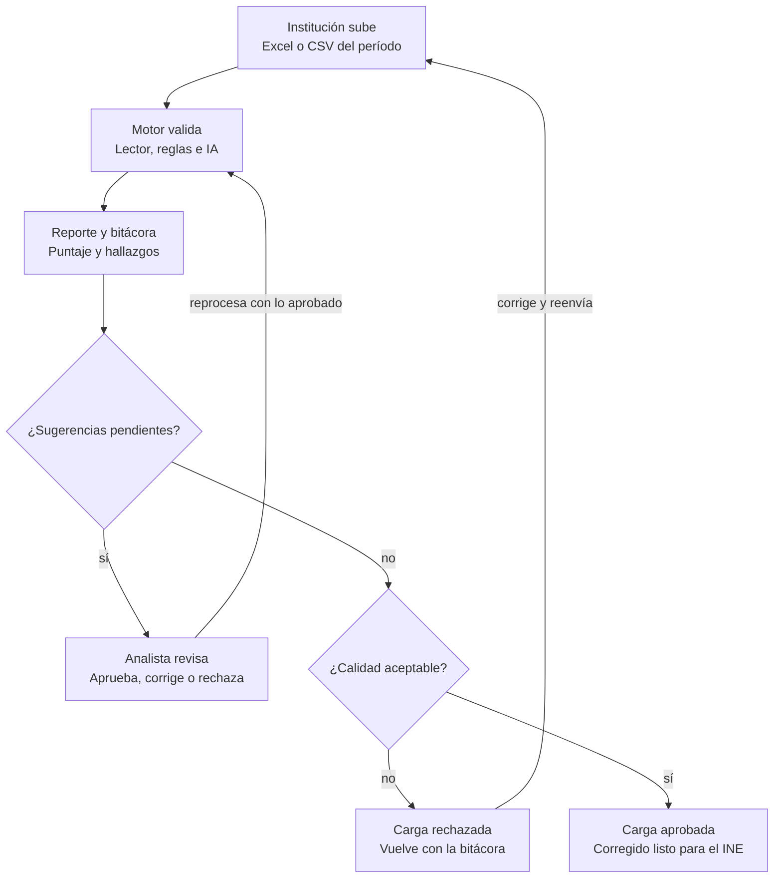

# Quality Audit — Documentación técnica del módulo de QA de bases de datos

Equipo Data Engineers · Datatón INE 2026 · Actualizada el 25 de noviembre de 2026

## Contenido

1. [Resumen](#resumen)
2. [Arquitectura](#arquitectura)
3. [Decisiones técnicas](#decisiones-técnicas)
4. [Flujo de una carga](#flujo-de-una-carga)
5. [Especificaciones](#especificaciones)
6. [API](#api)
7. [Codificador con IA](#codificador-con-ia)
8. [Validación contra lo publicado por el INE](#validación-contra-lo-publicado-por-el-ine)
9. [Costos](#costos)
10. [Rendimiento y escalabilidad](#rendimiento-y-escalabilidad)
11. [Seguridad y privacidad](#seguridad-y-privacidad)
12. [Limitaciones y mejoras](#limitaciones-y-mejoras)
13. [Instalación y operación](#instalación-y-operación)

## Resumen

Quality Audit revisa automáticamente las bases de datos que las instituciones públicas envían al INE, corrige lo que se puede corregir sin cambiar el significado y deja el resto como sugerencias para que un analista las apruebe. Con los crudos reales, el módulo procesa cada base en 1 a 7 segundos y en defunciones conserva exactamente los mismos 8,841 registros que publicó el INE.

**Problema.** Cada institución manda sus datos a su manera: nombres de columna distintos, texto donde va un código ("MASCULINO" en lugar de 1), "N.D." o "-1" para indicar que no hay dato, hojas con encabezados combinados y texto libre que el INE codifica a mano (motivos de detención, causas de muerte). Hoy eso se revisa con sintaxis y trabajo manual.

**Qué hace el módulo.**

- Lee el archivo como venga (Excel, CSV, una hoja por mes, formato ancho) y lo lleva a la estructura publicada por el INE.
- Revisa 7 dimensiones de calidad con 33 reglas y calcula un puntaje de 0 a 100.
- Corrige automáticamente lo seguro (espacios, textos de "sin dato", texto a código por equivalencia aprobada) y elimina los datos personales.
- Propone códigos para el texto libre con similitud de texto e IA, con confianza y justificación.
- Aprende: lo que el analista aprueba se aplica solo en la siguiente carga, y lo que rechaza no se vuelve a sugerir.
- Entrega el archivo corregido en formato INE, una bitácora de cada cambio y un reporte para la institución.

| Base | Institución | Registros recibidos | Válidos | Puntaje | Tiempo |
| --- | --- | --: | --: | --: | --: |
| Calidad del aire 2025 | INSIVUMEH | 166,440 lecturas | 75,240 | 88.8 | 7 s |
| Defunciones julio 2026 | RENAP | 10,034 | 8,841 | 97.8 | 7 s |
| Nacimientos junio 2026 | RENAP | 30,093 | 22,515 | 96.9 | 5 s |
| Emergencias 2025 | SECONRED | 7,337 | 7,337 | 96.6 | 1 s |
| Detenidos octubre 2026 | PNC | 4,255 | 4,255 | 98.0 | 1 s |

## Arquitectura

El módulo tiene un solo motor de validación, que usan tanto la API como la línea de comandos. La configuración de cada base vive en PostgreSQL, cargada desde archivos YAML y los diccionarios oficiales del INE.



El motor lee la configuración de PostgreSQL y guarda ahí los resultados; los archivos van al almacén. La IA solo recibe textos distintos para codificar. La API responde al front de inmediato y procesa cada carga en segundo plano.

**Por qué hay una línea de comandos.** El CLI usa el mismo motor sin levantar el servidor ni el front. Sirve para probar reglas, repetir la comparación con el INE y reprocesar en lote. Las instituciones no lo usan: ellas suben todo por el front.

## Decisiones técnicas

| Tecnología | Para qué | Por qué | Alternativa descartada |
| --- | --- | --- | --- |
| Python 3.11+ | Motor, scripts y API | Lo pide el reto; el equipo y el INE ya lo usan; tiene las mejores librerías de datos | — |
| pandas | Manejo de tablas en memoria | Estándar para limpiar y transformar datos tabulares | Polars: más rápido, pero las bases actuales (hasta 300 mil filas) no lo necesitan |
| python-calamine | Leer Excel | Lee los .xlsx varias veces más rápido que openpyxl | openpyxl (se usa solo para leer los diccionarios) |
| PostgreSQL 15+ | Configuración, hallazgos, bitácora y auditoría | Libre, robusto, con JSONB para parámetros y resúmenes; `UNIQUE NULLS NOT DISTINCT` evita equivalencias duplicadas | SQLite: no aguanta varios usuarios a la vez; MongoDB: la bitácora necesita relaciones |
| psycopg 3 | Conexión a PostgreSQL | Driver oficial moderno, sin ORM que esconda las consultas | SQLAlchemy: capa extra innecesaria para este tamaño |
| YAML | Definición de bases, catálogos y reglas | Legible por no programadores; queda versionado en Git | Configurar todo en código: cada cambio pediría un programador |
| FastAPI + Uvicorn | API para el front | La misma tecnología del transcriptor: se integran en un solo servidor; genera la documentación `/docs` sola | Django: más pesado; Flask: sin validación ni documentación automática |
| rapidfuzz | Sugerencias por similitud de texto | Encuentra errores de escritura en milisegundos, sin red y sin costo | difflib: demasiado lento para comparar contra 14 mil códigos CIE-10 |
| Claude Haiku 5.5 (API de Anthropic) | Codificar texto libre | Rápido y barato para clasificar; respuestas en JSON con esquema (structured outputs) | Modelos más grandes: más caros sin necesidad para clasificar |
| Ollama (opcional) | La misma codificación con un modelo local | Nada sale de la computadora, como en el transcriptor | — (queda como alternativa por privacidad; no probado con datos reales) |
| XlsxWriter | Escribir el archivo corregido y la bitácora | Rápido y con formato (anchos, encabezado fijo) | openpyxl: más lento para escribir |

**Por qué los registros no se guardan en la base de datos.** Los archivos van a una carpeta (almacén) y en PostgreSQL solo quedan metadatos, hallazgos y la bitácora. Así el CUI y los nombres de RENAP no quedan en tablas consultables y la base no crece 300 mil filas por envío.

**Por qué reglas en datos y no en código.** Cada regla tiene su severidad, acción y umbrales en la tabla `regla`. El INE puede cambiar "4 horas sin dato" por 6 sin tocar el motor.

**Por qué dos codificadores.** La similitud de texto resuelve gratis los errores de escritura; la IA solo recibe lo que necesita interpretación. Eso baja el costo y el tiempo.

## Flujo de una carga

Una carga pasa por la institución, el motor y el analista del INE; el archivo corregido solo queda listo para publicar cuando el analista la aprueba.



Lo que el analista aprueba queda como equivalencia de la institución: la siguiente carga ya llega codificada y la bandeja tiene menos pendientes. El detalle de qué tablas lee y escribe cada paso está en `schema.sql` y en `backend/README.md`.

## Especificaciones

### Bases soportadas

| Base | Institución | Periodicidad | Columnas publicadas | Formato del crudo | Referencia |
| --- | --- | --- | --: | --- | --- |
| `DEFUNCIONES` | RENAP | Mensual | 26 | Una hoja, 82 columnas con datos personales | Diccionario 2018-2022 y base publicada 2025 |
| `NACIMIENTOS` | RENAP | Mensual | 40 | Una hoja, 53 columnas | Diccionario 2018-2022 y base publicada 2025 |
| `DETENIDOS` | PNC | Mensual | 19 | Una hoja, encabezados repetidos | Diccionario PNC y base publicada 2023 |
| `CALIDAD_AIRE` | INSIVUMEH | Anual | 12 | Formato ancho: estación y PM en dos filas de encabezado | Base publicada 2025 |
| `EMERGENCIAS` | SECONRED | Anual | 26 | Una hoja por mes, 3 filas de encabezado combinadas | Base publicada 2022 |

Agregar una base nueva no requiere programar: se escribe su YAML en `config/bases/` y se corre `cargar_config`.

### Formatos de entrada

- Excel `.xlsx` y `.xls`, CSV y TXT con separador detectado (`;`, `,`, `|`, tabulador) y codificación UTF-8 o Latin-1.
- Tres formas: tabla simple, hojas mensuales que se unen y formato ancho que se pasa a una fila por lectura.
- Detecta encabezados repetidos, columnas vacías sin nombre, encabezados combinados y hojas con columnas distintas.

### Dimensiones de calidad y reglas

| Dimensión | Qué revisa | Reglas |
| --- | --- | --- |
| Estructura | Columnas faltantes, desconocidas, repetidas o vacías; datos personales; hojas distintas | 6 |
| Completitud | Datos faltantes, obligatorios vacíos, texto usado como "sin dato" | 3 |
| Validez | Código fuera de catálogo, tipo, rango, formato, espacios, texto libre sin codificar | 8 |
| Consistencia | Campos que no cuadran entre sí (hijos tenidos ≠ vivos + muertos, edad y mayoría de edad, día de la semana) | 5 |
| Unicidad | Registros duplicados por llave | 5 (una por base) |
| Oportunidad | Registros fuera del período de la carga | 4 |
| Representatividad | Meses de calidad del aire con datos insuficientes | 1 |

Una regla más, `DEF_OCURRIO_EXTRANJERO`, excluye defunciones ocurridas fuera de Guatemala. Total: 33 reglas.

**Severidades:** error (pesa 1), advertencia (pesa 0.5), informativo (no baja el puntaje).

**Acciones:** `auto_corregir` cambia el valor y lo anota; `sugerir` deja el valor y propone un código pendiente; `reportar` solo avisa; `excluir` saca el registro de la base publicable y guarda por qué.

### Fórmula del puntaje

Por dimensión, de 0 a 100:

- **Estructura:** 100 menos 15 por cada error y 5 por cada advertencia.
- **Reglas de una columna:** 100 menos 100 × Σ(peso × celdas afectadas) ÷ (registros × columnas publicadas).
- **Reglas de registro:** 100 menos 100 × Σ(peso × registros afectados) ÷ registros.

El puntaje global es el promedio de las dimensiones que aplican a la base.

### Transformaciones

13 recetas para calcular columnas del INE desde el crudo, por ejemplo `municipio_compuesto` (RENAP manda depto 1 y municipio 14, el INE publica 0114), `parte_fecha`, `agrupar_edad`, `padre_catalogo` (causa 20 → grupo 3) y `codificar_ia`. La lista completa está en `backend/README.md`.

### Catálogos

31 catálogos con 15,086 códigos, leídos de los diccionarios oficiales: 22 departamentos, 340 municipios, países, CIE-10 completo (14,362 códigos), 61 causas de PNC y los catálogos pequeños de cada base. Calidad del aire y emergencias no tienen diccionario oficial: sus catálogos se armaron desde las bases publicadas.

### Salidas de cada carga

| Salida | Contenido | Quién la usa |
| --- | --- | --- |
| `corregido.xlsx` | Base en el formato del INE, sin excluidos ni datos personales | INE |
| `bitacora.xlsx` | Resumen, hallazgos, cambios aplicados, sugerencias y excluidos | Institución y analista |
| `reporte.json` | Lo mismo para el front | Front |
| Tablas en PostgreSQL | Carga, ejecución, puntajes, hallazgos, correcciones, excluidos, auditoría | API y reportes históricos |

## API

La API es un `APIRouter` de FastAPI con prefijo `/api/qa`. Corre sola en el puerto 8001 o montada en la API unificada de la plataforma (`plataforma/app.py`, la que se publica en Vercel). La documentación interactiva está en `/docs`: ahí se puede probar cada endpoint sin front.

| Método | Ruta | Para qué |
| --- | --- | --- |
| GET | `/estado` | Si hay conexión a la base de datos |
| GET | `/bases` | Bases configuradas (selector al subir) |
| GET | `/bases/{codigo}` | Columnas y reglas de una base |
| POST | `/cargas/subida` | Registrar una carga y obtener dónde subir el archivo (JSON: `base`, `anio`, `mes`, `archivo`, `tamano`) |
| PUT | `/cargas/{id}/archivo` | Solo en modo local: recibir el archivo original |
| POST | `/cargas/{id}/procesar` | Validar el archivo subido en la misma petición y devolver el reporte |
| GET | `/cargas/{id}/reporte` | Reporte JSON de la última ejecución |
| POST | `/cargas` | Subir un archivo en una sola petición. Form: `file`, `base`, `anio`, `mes`, `usuario` |
| GET | `/cargas` | Historial, con filtros por base, estado e institución |
| GET | `/cargas/{id}` | Estado, avance, puntajes y resumen |
| GET | `/cargas/{id}/hallazgos` | Hallazgos, con filtros por severidad y dimensión |
| GET | `/cargas/{id}/sugerencias` | Bandeja de sugerencias |
| GET | `/cargas/{id}/excluidos` | Registros excluidos, agrupados por motivo |
| GET | `/cargas/{id}/descargar/{rol}` | `corregido`, `bitacora` o `reporte` |
| POST | `/cargas/{id}/reprocesar` | Volver a validar con lo ya aprobado |
| POST | `/cargas/{id}/aprobar` | El analista aprueba la carga |
| POST | `/cargas/{id}/rechazar` | El analista la devuelve a la institución |
| POST | `/sugerencias/{id}/aprobar` | Aprobar, o corregir con otro código |
| POST | `/sugerencias/{id}/rechazar` | Rechazar; no se vuelve a proponer |
| GET | `/catalogos/{codigo}?q=` | Buscar en un catálogo para corregir una sugerencia |

**Procesamiento en segundo plano.** Igual que el transcriptor: `POST /cargas` guarda el archivo y responde de inmediato con el `carga_id`; el motor corre en un `ThreadPoolExecutor` y el front consulta `GET /cargas/{id}` cada segundo. El campo `avance` trae `estado` (en_cola, procesando, terminado, error), `etapa` y `porcentaje` para la barra.

**Pantallas que necesita el front:** subir archivo con barra de avance, reporte de calidad (puntaje, dimensiones, hallazgos, descargas), bandeja de sugerencias (aprobar, corregir, rechazar), historial de cargas y vista del analista para aprobar o rechazar la carga.

**Archivos: Supabase Storage o disco** (`qa/almacenamiento.py`). Con `SUPABASE_URL` y `SUPABASE_SERVICE_ROLE_KEY`, el original y los resultados viven en el bucket privado `qa-cargas` (`cargas/<carga_id>/…`): el navegador sube el original con una URL firmada y las descargas devuelven `{"url": …}` firmada por 5 minutos. Sin Supabase (o con `QA_ALMACENAMIENTO=local`) todo queda en `QA_ALMACEN`, como antes. La columna `archivo.ruta` guarda `supabase://<bucket>/<objeto>` o la ruta local.

**En Vercel** no hay hilos en segundo plano ni disco persistente: `/cargas/{id}/procesar` valida dentro de la petición (hasta 300 s) usando `/tmp`, y `POST /cargas` y `/reprocesar` también corren en la misma petición (`QA_PROCESAMIENTO=sincrono` fuerza ese modo fuera de Vercel). Las conexiones usan `prepare_threshold=None` para funcionar con el pooler de Supabase en modo transacción.

**Usuario.** En la plataforma, las acciones quedan a nombre del correo con el que se inició sesión en Supabase Auth; la primera vez se crea en `usuario` con rol `analista_ine`. El campo `usuario` de los formularios sigue funcionando para uso directo de la API.

**Integración con la interfaz.** La API unificada (`plataforma/app.py`) monta este router junto con Audio Audit y las extensiones; las rutas no chocan (`/api/qa/*`, `/api/surveys/*`, `/api/improvement/*` y las de audio). En local se arranca desde la raíz con `uvicorn api.index:app --port 8000`; `iniciar_api.bat` sigue sirviendo para probar este módulo solo, en el puerto 8001.

## Codificador con IA

La IA propone el código oficial para el texto libre que hoy el INE codifica a mano. En la prueba real con Claude Haiku 5.5 codificó correctamente 7 de 8 motivos de PNC, 7 de 7 causas de muerte y 5 de 5 sitios, y dejó sin código el único texto ambiguo en lugar de adivinar.

| Columna | Catálogo | Ejemplo real | Textos distintos en los crudos |
| --- | --- | --- | --: |
| Motivo de detención (PNC) | 61 causas | "EXTORSION Y ASOCIACION ILICITA" → 40 Extorsión, conf. 0.75 | 531 |
| Causa de muerte (RENAP) | CIE-10, 14,362 códigos | "Infarto Agudo al Miocardio" → I219, conf. 0.90 | 3,154 |
| Sitio de la defunción (RENAP) | 9 tipos | "IGSS Zona 9" → 4 Seguro social, conf. 0.97 | 7,108 |
| Ocupación (no se publica desde 2025) | CIUO-08 | — | — |

### Cómo trabaja

1. Lo que la similitud de texto resuelve con 95 % o más no se manda a la IA ("TENECIA DE DROGA" → 42).
2. El resto va en lotes de 40 textos, 4 en paralelo. Con catálogos chicos se manda la lista completa; con CIE-10, los 15 códigos más parecidos por texto.
3. Las instrucciones tienen reglas por catálogo: en PNC se codifica el delito más grave y las faltas sin causa propia van a 68 "Otras causas"; en CIE-10 el INE escribe con X las categorías sin subcategoría (I10X).
4. La respuesta llega en JSON con esquema fijo (structured outputs): código, confianza de 0 a 1 y una justificación corta.
5. Cada código se valida contra el catálogo; los inexistentes se descartan. Si la respuesta omite textos, se piden de nuevo una vez.
6. Si un lote falla (sin red, sin clave, error del servicio), ese lote usa similitud de texto y la carga continúa.
7. Las sugerencias se guardan sin aprobar: la siguiente carga no vuelve a pagar por los mismos textos.

Se muestran sugerencias con confianza ≥ 0.6. Todas quedan **pendientes** hasta que un analista las aprueba.

### Configuración

| Variable | Valor | Para qué |
| --- | --- | --- |
| `QA_IA_PROVEEDOR` | `anthropic`, `ollama` o `ninguno` | Quién codifica |
| `ANTHROPIC_API_KEY` | Clave de console.anthropic.com | Acceso a Claude |
| `QA_IA_MODELO` | `claude-haiku-5-5` | Modelo |
| `QA_IA_CATALOGOS` | `PNC_CAUSA,CIE10,DEF_SITIO,OCUPACION_CIUO08` | Qué se manda a la IA |
| `QA_IA_LOTE` / `QA_IA_PARALELO` | 40 / 4 | Tamaño de lote y llamadas simultáneas |

Sin clave, el sistema funciona igual con similitud de texto.

## Validación contra lo publicado por el INE

El motor se comparó con el resultado real del INE en las dos bases donde hay con qué comparar. El script `scripts/comparar_con_ine.py` reproduce ambas comparaciones.

**Defunciones: coincidencia exacta.** El archivo de RENAP de julio 2026 trae dos hojas: la cruda (10,034 registros) y la que dejó el INE (8,841). El motor conserva exactamente los mismos 8,841 registros, comparados uno por uno por MOVIMIENTO, SEDE y FECHA. Excluye las defunciones ocurridas en otros años y las ocurridas fuera de Guatemala; esa segunda regla no estaba documentada y se dedujo de la comparación.

**Calidad del aire: misma regla, aplicada de forma consistente.** La regla del INE es descartar un mes si tiene más de 2 días con más de 4 horas sin dato. En 11 de las 19 combinaciones de estación y PM el motor conserva exactamente los mismos meses que la publicación 2025. En las otras 8 la diferencia es de un mes y la decisión del INE no se explica con su propia regla:

- Mayo de Correos PM10: el INE lo excluyó, pero solo le faltan 2 horas en todo el mes.
- Agosto de Salamá PM10: el INE lo conservó, pero tiene 3 días inválidos.

El motor aplica la regla igual en todos los casos, y los umbrales se pueden cambiar en la tabla `regla` si el INE usa otro criterio.

**Lo que no se pudo validar todavía.** Nacimientos, PNC y emergencias no tienen versión procesada del mismo período; se validaron contra la estructura de sus bases publicadas (columnas y códigos). La precisión de la IA se midió con 20 ejemplos; falta una muestra ya codificada por el INE.

## Costos

El único gasto variable es la API de Claude para el codificador con IA: unos 0.32 USD la primera carga de defunciones y menos de 2 centavos una de PNC. Todo lo demás es software libre y corre en una computadora del INE.

### Software e infraestructura

| Componente | Licencia | Costo |
| --- | --- | --- |
| Python, pandas, FastAPI, Uvicorn, psycopg, rapidfuzz, XlsxWriter, python-calamine, PyYAML | Libres (BSD, MIT, Apache) | 0 |
| PostgreSQL | Libre (PostgreSQL License) | 0 |
| Ollama y modelos abiertos (opcional) | Libres | 0; usa el procesador o la GPU de la computadora |
| Servidor | — | Con los archivos actuales corre en una laptop; en producción, un servidor del INE |

### API de Claude

Precio de Claude Haiku 5.5 para prompts de hasta 100 mil tokens: 0.10 USD por millón de tokens de entrada y 0.50 USD por millón de salida. Con la Batch API (procesamiento no inmediato) el precio baja a la mitad. Fuente: [Pricing, documentación de Claude](https://platform.claude.com/docs/en/about-claude/pricing), consultada el 25 de noviembre de 2026.

Estimación por carga, con lotes de 40 textos. Los tokens son aproximados; el consumo real se ve en la consola de Anthropic.

| Carga | Textos que van a la IA | Llamadas | Tokens de entrada | Tokens de salida | Costo estimado |
| --- | --: | --: | --: | --: | --: |
| Defunciones, primera carga (CIE-10 + sitio) | ~10,000 | ~250 | ~940 mil | ~450 mil | ~0.32 USD |
| PNC, primera carga | ~520 | ~13 | ~22 mil | ~23 mil | ~0.014 USD |
| Cargas siguientes | Solo textos nuevos | Menos | — | — | Una fracción de la primera |

Cómo se estimó: un lote de CIE-10 lleva unos 10 mil tokens (40 textos con 15 candidatos cada uno), uno de PNC unos 1,700 (con la lista de 61 causas) y uno de sitio unos 1,100. Cada lote devuelve unos 1,800 tokens.

**Lo que mantiene bajo el costo:**

- Lo que la similitud de texto resuelve no va a la IA.
- Las sugerencias se guardan: un texto se paga una sola vez, aunque aparezca en todas las cargas.
- Solo se mandan textos distintos: "Paro Cardiorrespiratorio" con 333 registros cuenta como un texto.

**Para bajar más el costo:** Batch API (50 % menos, sirve si la carga no necesita respuesta inmediata), caché de instrucciones (las instrucciones y la lista de PNC se repiten en cada lote) u Ollama con un modelo local (sin costo por uso, más lento y con menos precisión esperada).

## Rendimiento y escalabilidad

Con los volúmenes actuales del INE el módulo sobra: la base más grande (166 mil lecturas de aire) se procesa en 7 segundos, y la base anual más grande publicada (345 mil nacimientos en 2022) está dentro de lo que maneja en memoria. Los límites están en la operación con muchos usuarios a la vez, no en el tamaño de los archivos.

### Límites actuales y cómo superarlos

| Límite actual | Efecto | Cómo escalar |
| --- | --- | --- |
| Un solo trabajador (`ThreadPoolExecutor` de 1) | Las cargas se procesan una tras otra | Cola de trabajos (RQ o Celery con Redis) y varios trabajadores |
| El avance se guarda en memoria | Si se reinicia el servidor se pierde la barra de avance (los resultados no) | Guardar el avance en la tabla `carga` o en Redis |
| Archivos en una carpeta local | Un solo servidor | Almacenamiento de objetos (MinIO dentro del INE o S3) |
| El archivo completo se carga en memoria con pandas | Bien hasta varios millones de celdas | Lectura por bloques o Polars para bases de millones de filas |
| Salida en Excel | Excel admite hasta 1,048,576 filas por hoja | CSV o Parquet para bases más grandes |
| Una conexión a PostgreSQL por consulta | Suficiente para pocos usuarios | Pool de conexiones (`psycopg_pool`) |
| `correccion` y `hallazgo` crecen con cada carga | Consultas más lentas en años | Partición por fecha y archivo de ejecuciones viejas |
| IA en llamadas síncronas | La primera carga de defunciones tarda varios minutos | Batch API (50 % más barata) para cargas que pueden esperar |

### Agregar instituciones y bases

Escala sin programar: una base nueva es un YAML con sus columnas, alias, catálogos y transformaciones. Las reglas genéricas (estructura, completitud, validez, unicidad) le aplican de inmediato; solo las reglas que cruzan varias columnas necesitan una función en `reglas.py`.

### Despliegue sugerido para producción

Un servidor del INE con la API detrás de Nginx (HTTPS), PostgreSQL en el mismo servidor o en uno dedicado, la cola de trabajos con Redis y el almacén de archivos cifrado. Todo cabe en contenedores Docker para instalarlo igual en desarrollo y producción.

## Seguridad y privacidad

Los crudos de RENAP y PNC traen CUI, nombres, direcciones y datos de investigación policial. El módulo los protege así:

| Medida | Estado |
| --- | --- |
| Las columnas personales se eliminan del archivo corregido (34 en defunciones, 17 en PNC) | Hecho |
| Los registros no se guardan en PostgreSQL: solo metadatos, hallazgos y bitácora | Hecho |
| El archivo original no se puede descargar desde la API | Hecho |
| A la IA solo van textos distintos de una columna, sin filas, nombres, CUI ni fechas; las cifras de 6 o más dígitos se enmascaran | Hecho |
| "Quien certifica" (nombres de médicos) no se manda a la IA | Hecho |
| Opción de IA local con Ollama: nada sale de la computadora | Hecho |
| Auditoría de acciones: subir, reprocesar, aprobar, rechazar | Hecho |
| Claves y contraseñas solo en `.env`, fuera de Git; crudos y almacén fuera del repositorio | Hecho |
| Login y permisos por rol (institución, analista, admin) | Pendiente: hoy el usuario es un email opcional |
| Cifrado del almacén de archivos originales | Pendiente |
| HTTPS | Pendiente (se resuelve con Nginx en el despliegue) |
| Política de retención: borrar originales después de aprobada la carga | Pendiente |

Antes de usarlo con datos reales fuera del datatón, hay que completar los cuatro pendientes y confirmar con el INE si puede usar un servicio de IA externo o debe usar el modelo local.

## Limitaciones y mejoras

### Limitaciones conocidas

- **Causa básica de muerte:** la IA codifica la causa A (la primera que escribe el médico). El INE publica la causa básica, que se obtiene de la cadena A → D según las reglas de la OMS.
- **Precisión de la IA sin medir a escala:** se probó con 20 ejemplos; falta una muestra codificada por el INE para medir aciertos por catálogo.
- **Diccionarios de 2018-2022:** la publicación 2025 ya no trae ocupación y puede tener códigos nuevos que el diccionario no tiene.
- **Calidad del aire y emergencias** usan catálogos armados desde las bases publicadas, no desde un diccionario oficial.
- **Sin login** ni permisos por rol (ver Seguridad).

### Mejoras propuestas

| Mejora | Beneficio | Esfuerzo |
| --- | --- | --- |
| Login y roles | Uso real por instituciones y analistas | Medio |
| Causa básica con la cadena completa A → D | Codificación de mortalidad comparable con la del INE | Medio |
| Medir la precisión de la IA con una muestra del INE | Saber en qué catálogos se puede confiar más | Bajo |
| Aprobación masiva de sugerencias con confianza alta | Menos clics para el analista | Bajo |
| Cola de trabajos y avance persistente | Varias cargas a la vez y sin pérdida al reiniciar | Medio |
| Batch API y caché de instrucciones | Hasta 50 % menos costo de IA | Bajo |
| Tablero histórico por institución | Ver si la calidad de cada fuente mejora mes a mes | Medio |
| Reporte en PDF para la institución | Retroalimentación formal sin entrar al sistema | Bajo |
| Validación en el origen (plantilla o API para las instituciones) | Menos errores desde el envío | Alto |

## Instalación y operación

Requisitos: Windows, Linux o macOS; Python 3.11 o superior; PostgreSQL 15 o superior; los diccionarios del INE. Opcional: clave de la API de Claude u Ollama.

### Puesta en marcha (PowerShell)

```powershell
cd Data_Engineers_Datat-n2026\data-audit\qa_bases_datos
python -m venv .venv
.\.venv\Scripts\Activate.ps1
pip install -r backend\requirements.txt
copy .env.example .env          # poner DATABASE_URL y, si se usa IA, ANTHROPIC_API_KEY

createdb -U postgres quality_audit
psql -U postgres -d quality_audit -f schema.sql

cd backend
python -m scripts.cargar_config --dicc-defunciones <ruta> --dicc-nacimientos <ruta> --dicc-pnc <ruta>
cd ..
.\iniciar_api.bat               # http://localhost:8001/docs
```

`cargar_config` se vuelve a correr cada vez que cambian los YAML de configuración; actualiza sin duplicar.

### Comandos útiles

| Comando (desde `backend`) | Para qué |
| --- | --- |
| `python -m qa.cli bases` | Listar las bases configuradas |
| `python -m qa.cli procesar --base DETENIDOS --archivo <xlsx> --anio 2026 --mes 10` | Validar un archivo sin la API |
| `python -m scripts.probar_ia` | Probar el codificador con IA con ejemplos |
| `python -m scripts.comparar_con_ine defunciones --crudo <xlsx>` | Repetir la comparación con el INE |

### Estructura del repositorio

```
data-audit/qa_bases_datos/
├── DOCUMENTACION.md        Este documento
├── schema.sql              Esquema PostgreSQL (19 tablas)
├── .env.example            Configuración (copiar como .env)
├── iniciar_api.bat         Levanta la API en el puerto 8001
└── backend/
    ├── config/
    │   ├── bases/          Una definición YAML por base
    │   ├── catalogos.yaml  31 catálogos y equivalencias conocidas
    │   └── reglas.yaml     Reglas de calidad
    ├── qa/
    │   ├── lector.py           Lee el crudo
    │   ├── definicion.py       Lee la configuración de PostgreSQL
    │   ├── transformaciones.py Calcula columnas del INE
    │   ├── motor.py            Orquesta y calcula el puntaje
    │   ├── reglas.py           Reglas de varias columnas
    │   ├── codificador.py      Similitud de texto
    │   ├── codificador_ia.py   IA (Claude u Ollama)
    │   ├── salidas.py          Archivos y guardado en la BD
    │   ├── api.py, servidor.py API FastAPI
    │   └── cli.py              Línea de comandos
    ├── scripts/            cargar_config, comparar_con_ine, probar_ia
    └── README.md
```

No se suben a Git: `.env`, `almacen/` (copias de los crudos) ni los Excel y CSV de las instituciones.
