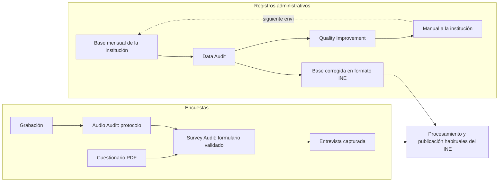

# Aplicabilidad institucional

Quality Audit se diseñó para encajar en procesos que el INE ya realiza: supervisar entrevistas, capturar encuestas, recibir y depurar registros administrativos de otras instituciones, y retroalimentarlas. Este documento explica a quién sirve, cómo se adoptaría y qué beneficios se esperan, separando lo **medido** de lo **potencial**.

## 1. Problema que atiende

El INE produce estadísticas a partir de dos tipos de fuente con problemas de calidad distintos:

- **Encuestas** (p. ej., ENCOVI): los errores nacen en campo. La supervisión de entrevistas es muestral y manual (escuchar grabaciones, revisitar hogares), y los errores de captura se descubren tarde.
- **Registros administrativos** (RENAP, PNC, INSIVUMEH, SECONRED): cada institución envía sus bases con formatos, nombres de columna, códigos y textos propios. La depuración se hace con sintaxis y trabajo manual, se repite cada mes y los mismos errores vuelven porque no hay un mecanismo sistemático para retroalimentar a la institución.

## 2. Un módulo por proceso institucional

| Módulo | Proceso del INE | Qué cambia |
|---|---|---|
| **Audio Audit** | Supervisión de entrevistas | Revisar el 100 % de las grabaciones con un puntaje por reglas del manual, y que el supervisor escuche solo los minutos señalados como riesgo |
| **Survey Audit** | Captura validada | El formulario rechaza respuestas fuera de catálogo o de rango y respeta los pases; la grabación verifica lo registrado sin alterarlo |
| **Data Audit** | Depuración y control de registros administrativos | Lectura automática de cualquier formato, recodificación a códigos oficiales, exclusiones con motivo, bitácora y base en formato INE en segundos |
| **Quality Improvement** | Prevención de errores recurrentes | Cada hallazgo se convierte en una recomendación aprobada y en un manual para la institución que generó el dato |

## 3. Beneficiarios

| Tipo | Quiénes | Beneficio |
|---|---|---|
| Directos | Analistas de registros administrativos y estadísticas vitales | Menos trabajo manual repetitivo; bitácora de cada cambio |
| Directos | Supervisores y coordinadores de campo de encuestas | Supervisión de más entrevistas con evidencia por minuto |
| Directos | Encuestadores y digitadores | Retroalimentación inmediata al capturar |
| Directos | Unidades de calidad / metodología | Indicadores comparables por dimensión, base y período |
| Indirectos | RENAP, PNC, INSIVUMEH, SECONRED y otras fuentes | Manuales concretos sobre qué corregir en su sistema de origen |
| Indirectos | Usuarios de estadísticas oficiales (gobierno, academia, ciudadanía) | Estadísticas más consistentes y publicadas con menos retraso |
| Indirectos | Sistema Estadístico Nacional | Un método común y reutilizable de control de calidad |

## 4. Dependencias usuarias (propuesta)

Según la estructura funcional típica de un instituto de estadística; la asignación final corresponde al INE:

- Áreas de **registros administrativos y estadísticas continuas** (vitales, seguridad, ambiente): Data Audit y Quality Improvement.
- Áreas de **encuestas de hogares** (ENCOVI, ENEI): Survey Audit y Audio Audit.
- Área de **calidad / metodología**: definición de reglas, umbrales y aprobación de manuales.
- Área de **tecnología**: operación de la infraestructura y cuentas.
- **Coordinación interinstitucional**: entrega de manuales a las instituciones fuente.

## 5. Integración con los procesos existentes

- **No reemplaza** los sistemas de captura, procesamiento ni publicación del INE: se sitúa antes (validación) y al lado (supervisión, retroalimentación).
- **Entradas y salidas estándar:** Excel/CSV, PDF, JSON y la base corregida en la estructura publicada por el INE.
- **Configurable sin programar:** nuevas bases, reglas, catálogos y umbrales se agregan con un archivo YAML y una tabla en PostgreSQL.
- **Se adapta a otras fuentes estadísticas:** las cinco bases probadas tienen formatos muy distintos (una hoja, hojas mensuales, formato ancho, encabezados combinados).

## 6. Recursos para adoptarlo

| Recurso | Necesidad mínima | Observación |
|---|---|---|
| Servidor | 2 vCPU, 4–8 GB RAM, PostgreSQL 16 | Medido: 2 vCPU / 7 GB procesan las bases reales en 1–7 s |
| GPU (opcional) | Para transcribir localmente sin enviar audio a terceros | No medido |
| Software | Todo libre (Python, PostgreSQL, Node para compilar) | Sin costo de licencia |
| Servicios de IA | Opcionales, pago por uso | Ver costos en [IA y servicios](ia-y-servicios.md) |
| Personal técnico | 1 persona de TI para operación; 1 analista por área para mantener reglas y catálogos | Perfil Python/SQL básico para TI |
| Capacitación | Usuarios finales: 2–4 horas con el [manual de usuario](user-guide.md); TI: 1 día con la [instalación](installation.md) y la [arquitectura](architecture.md) | Propuesta |

## 7. Mantenimiento

- **Reglas y catálogos:** actualizar los diccionarios y volver a correr `cargar_config` cuando el INE publique nuevas versiones.
- **Equivalencias:** se mantienen solas con las aprobaciones de los analistas; se revisan desde «Correcciones guardadas».
- **Plantillas de recomendaciones y reglas JEV:** archivos versionados (`reglas.json`, `rules_a1_a2.py`) y editor de reglas en la interfaz.
- **Dependencias:** actualización anual de librerías y verificación con las pruebas automáticas.

## 8. Beneficios: medidos y potenciales

| Beneficio | Estado | Evidencia |
|---|---|---|
| Procesar una base mensual en segundos (1–7 s por base real) | **Medido** | [Pruebas](testing.md#resultados-con-crudos-reales) |
| Reproducir exactamente la depuración del INE en defunciones (8 841/8 841 registros) | **Medido** | Ídem |
| Aplicar de forma consistente la regla de representatividad del aire (11/19 iguales; 8 diferencias explicadas) | **Medido** | Ídem |
| Reconocer todas las columnas de los crudos (salvo una sin nombre) | **Medido** | Ídem |
| Detectar códigos inexistentes y datos faltantes en las fuentes (p. ej., 19 % de nacimientos sin departamento) | **Medido** | Ídem |
| Codificar texto libre con IA (19/20 en muestra pequeña) | **Medido, muestra pequeña** | Ídem |
| Reducir horas de depuración manual por base | Potencial | Requiere medir tiempos actuales del INE |
| Supervisar el 100 % de las entrevistas en lugar de una muestra | Potencial | Requiere validar JEV con grabaciones reales |
| Disminuir errores recurrentes de las instituciones con los manuales | Potencial | Requiere comparar reportes de períodos sucesivos |
| Reducir errores de captura en campo | Potencial | Requiere piloto con encuestadores |

## 9. Escalabilidad: propuesta de evolución

Fases propuestas por el equipo como **ruta de evolución posible; no son compromisos del INE** ni de ninguna otra institución.

| Fase | Objetivo | Actividades | Criterio para avanzar |
|---|---|---|---|
| **1. Prototipo Datatón** (actual) | Demostrar los cuatro módulos integrados | Plataforma publicada, pruebas con crudos reales en Data Audit y datos sintéticos en el resto | Evaluación del jurado |
| **2. Validación con personal técnico del INE** | Confirmar reglas, umbrales y utilidad | Talleres con analistas; definir la codificación de casos especiales (causas PNC, «Consular», meses de aire); medir tiempos actuales | Reglas aprobadas por el área técnica |
| **3. Pruebas piloto autorizadas** | Medir con datos reales en un entorno controlado | Una base mensual de registros administrativos y una muestra de entrevistas grabadas con autorización; medir WER, DER, exactitud de JEV y de conciliación | Métricas aceptables definidas con el INE |
| **4. Optimización** | Preparar para uso continuo | Roles por institución, retención automática, normalización de tablas, cola de trabajos, modelos locales donde se requiera | Pruebas de carga y de seguridad aprobadas |
| **5. Integración con sistemas institucionales** | Operar dentro de la infraestructura del INE | Despliegue en servidores del INE, autenticación institucional, conexión con los sistemas de captura y procesamiento existentes | Operación estable en producción |
| **6. Escalamiento en el Sistema Estadístico Nacional** | Extender el método a otras instituciones productoras de datos | Nuevas bases y reglas por YAML; manuales a cada institución fuente; capacitación | Adopción voluntaria por otras instituciones |
