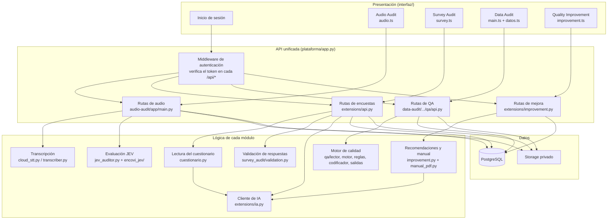
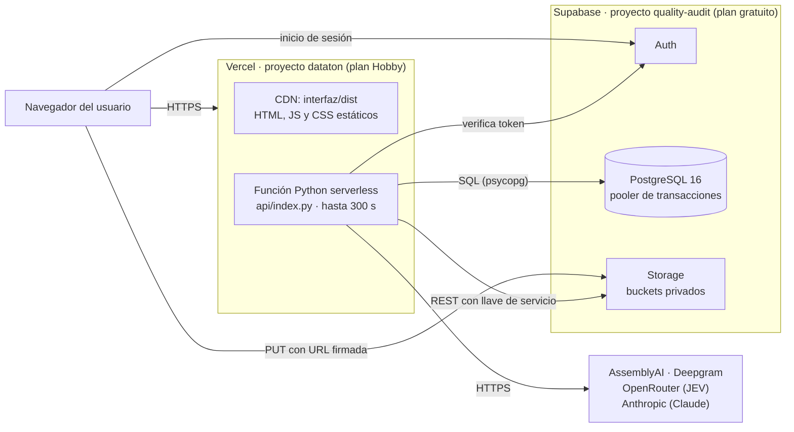
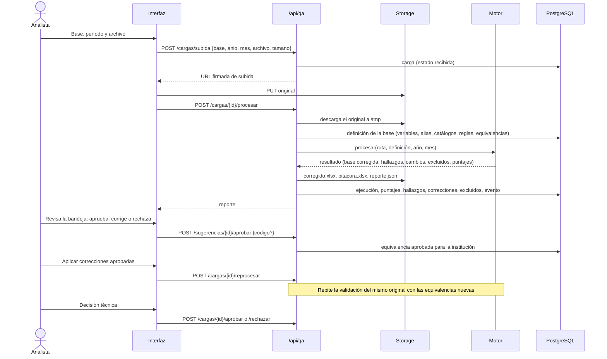
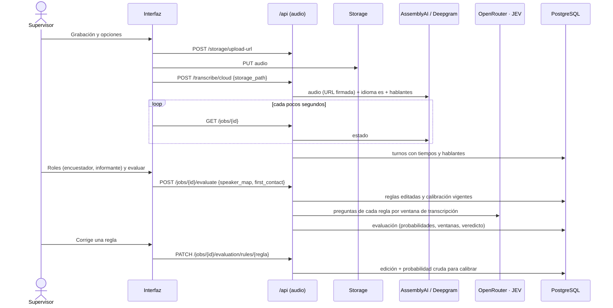
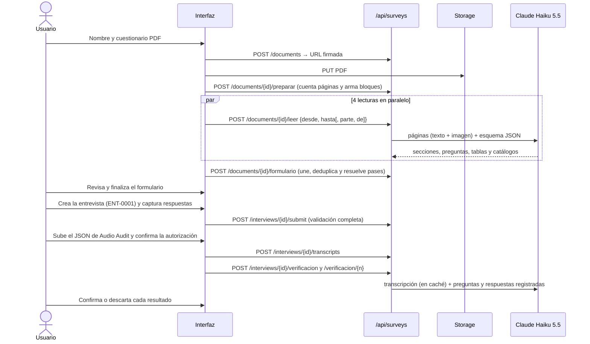
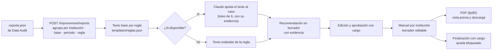
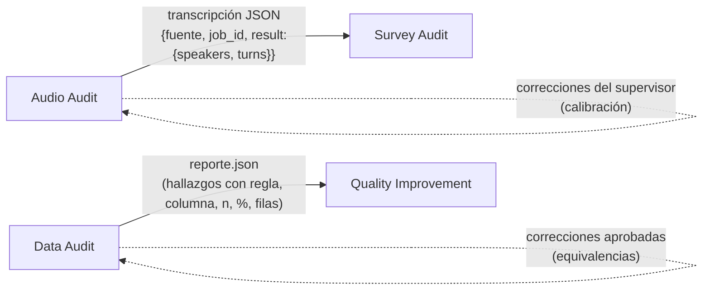

# Arquitectura

Este documento describe cómo está construido Quality Audit:

- Arquitectura lógica (qué componentes hay y qué hace cada uno).
- Arquitectura física (dónde corre cada componente).
- Flujos de información de cada módulo y comunicación entre módulos.
- Dependencias, formatos de entrada y salida, y decisiones de diseño.

El modelo de datos está en [modelo-datos.md](modelo-datos.md) y la API en [api-referencia.md](api-referencia.md).

## 1. Arquitectura lógica

Quality Audit tiene cuatro módulos de negocio que comparten una interfaz, una API, un servicio de identidad, una base de datos y un almacenamiento de archivos.

| Capa | Responsabilidad | Código |
|---|---|---|
| Presentación | Pantallas, validación básica en el navegador, subida directa de archivos y mensajes claros | `interfaz/src/` (TypeScript sin framework, con Vite) |
| Seguridad | Exigir sesión en toda ruta `/api/*` y registrar quién hace cada acción | `plataforma/app.py` (middleware ASGI) |
| API | Validar entradas (Pydantic), ordenar los pasos y responder JSON | Un `APIRouter` por módulo |
| Lógica | Algoritmos de cada módulo, independientes de la web | `qa/`, `encovi_jev/`, `extensions/`, `survey_audit/` |
| Datos | Persistencia estructurada y de archivos | PostgreSQL y Supabase Storage |

Cada módulo de lógica se puede usar sin la web. Data Audit tiene línea de comandos (`python -m qa.cli`) y JEV tiene `encovi_jev/audit.py`. Así los algoritmos se prueban y reproducen sin levantar la plataforma.

## 2. Arquitectura física

### Despliegue en línea (el que usa el jurado)

- **Una sola función** atiende todas las rutas `/api/*` (`vercel.json` reescribe `/api/(.*)` a `api/index.py`). El paquete de la función excluye pruebas, documentación y código de interfaz para mantenerse por debajo del límite de tamaño.
- **Encabezados de seguridad** en todas las respuestas: `X-Content-Type-Options: nosniff`, `Referrer-Policy: strict-origin-when-cross-origin` y `X-Frame-Options: DENY`.
- **Sin estado en la función:** todo lo que debe persistir va a PostgreSQL o Storage. Lo temporal usa `/tmp` y se pierde al terminar.

### Ejecución local (desarrollo o instalación en un servidor del INE)

| Proceso | Comando | Puerto |
|---|---|---|
| API unificada | `uvicorn api.index:app --port 8000` | 8000 |
| Interfaz (desarrollo) | `npm run dev` en `interfaz/` (reenvía `/api/*` al 8000) | 5173 |
| PostgreSQL | servicio del sistema | 5432 |
| Transcripción local opcional | WhisperX + Pyannote en GPU (`audio-audit/requirements-local.txt`) | dentro del proceso de la API |

Sin variables de Supabase, la API **no pide inicio de sesión pero solo atiende a `localhost`**, y los archivos se guardan en carpetas locales. Con las variables, se comporta igual que en línea. Detalle en [installation.md](installation.md).

## 3. Flujos de información

### Data Audit: de la base institucional a la base corregida

### Audio Audit: de la grabación al puntaje

### Survey Audit: del PDF a la entrevista verificada

### Quality Improvement: de los hallazgos al manual

## 4. Comunicación e integración entre módulos

| Origen → destino | Qué se transfiere | Cómo | Validaciones |
|---|---|---|---|
| Audio Audit → Survey Audit | Turnos con hablante, inicio y fin | El supervisor descarga el JSON y lo vincula a la entrevista | Autorización de uso confirmada; código de entrevista coincidente; la misma grabación (mismo `job_id` o huella SHA-256) no se vincula a otra entrevista |
| Data Audit → Quality Improvement | Hallazgos de una carga | Importación manual de `reporte.json` | Se ignoran datos de filas; solo números de fila como evidencia. Reimportar el mismo período actualiza sin duplicar |
| Data Audit → Data Audit | Equivalencias aprobadas | Tabla `equivalencia` | Única por catálogo, institución y texto |
| Audio Audit → Audio Audit | Ediciones del supervisor | `audio_audit_evaluation_edits` → `audio_audit_calibration` | Mínimo 30 etiquetas por grupo; parámetros ligados a la versión del modelo |

La transferencia entre módulos es **manual a propósito**. Así una persona decide qué grabación corresponde a qué entrevista y qué reporte se convierte en recomendaciones, y queda constancia de esa decisión.

## 5. Formatos de entrada y salida

| Módulo | Entradas | Salidas |
|---|---|---|
| Data Audit | XLSX, XLS, CSV o TXT con separador `;`, `,`, `\|` o tabulador y codificación UTF-8 o Latin-1. Máximo 50 MB (configurable con `QA_MAX_MB`). Tres formas: tabla simple, una hoja por mes, formato ancho | `corregido.xlsx` (estructura INE, sin datos personales ni excluidos); `bitacora.xlsx` (resumen, hallazgos, cambios, sugerencias, excluidos); `reporte.json`; el original guardado |
| Audio Audit | Audio (MP3, WAV, M4A, OGG, MP4 u otros que acepte el proveedor) hasta 50 MB; transcripción `.json` (turnos) o `.txt` (marcas de hablante) hasta 5 MB | Transcripción TXT; JSON para Survey Audit; reporte de evaluación JEV en JSON |
| Survey Audit | Cuestionario PDF hasta 50 MB (sin cifrar); JSON de Audio Audit | Formulario (esquema JSON v2); entrevistas con respuestas; resultados de verificación con evidencia |
| Quality Improvement | `reporte.json` de Data Audit | Recomendaciones; manual institucional en PDF tamaño carta |

**Esquema de formulario (v2)** de Survey Audit: secciones con alcance `household` o `person`; preguntas con `id`, `codigo`, `label`, `type` (`text`, `integer`, `decimal`, `date`, `single_select`, `multi_select`), `required`, `options[{code, label, pase_a}]`, `pase_a {tipo: pregunta|seccion|fin, destino}`, `constraints {min, max}`, `instrucciones`, `pagina` y `alertas`. Las secciones por persona se repiten según `_personas` y sus respuestas se guardan como `pregunta#n`.

## 6. Dependencias

| Componente | Depende de | Si falta |
|---|---|---|
| Toda la plataforma en línea | Vercel, Supabase (Auth, PostgreSQL, Storage) | No hay servicio |
| Data Audit | PostgreSQL con esquema y configuración cargados | No hay bases para elegir |
| Codificación con IA (Data Audit) | `ANTHROPIC_API_KEY` | Sigue con similitud de texto (RapidFuzz) |
| Transcripción en la nube | `ASSEMBLYAI_API_KEY` o `DEEPGRAM_API_KEY` | Se puede cargar una transcripción `.json`/`.txt`, o usar WhisperX local |
| Evaluación JEV | `OPENROUTER_API_KEY` | Se transcribe y se revisa el texto, pero no se calcula el puntaje |
| Survey Audit (leer PDF y verificar) | `ANTHROPIC_API_KEY` | No se puede generar el formulario; validación y captura sí funcionan |
| Quality Improvement | — | Sin IA usa el texto estándar de cada regla |

Las versiones y licencias de cada librería están en [licencias.md](licencias.md).

## 7. Decisiones de diseño

| Decisión | Alternativas consideradas | Por qué |
|---|---|---|
| Una API y un despliegue para los cuatro módulos | Un servicio por módulo | Un solo inicio de sesión, un solo lugar que configurar y cero costo; las rutas no chocan (`/api/qa`, `/api/surveys`, `/api/improvement`) |
| Reglas, umbrales y estructura de bases en datos (YAML → PostgreSQL) | Reglas en código | El INE puede cambiar un umbral o agregar una base sin programar |
| No guardar registros individuales en PostgreSQL | Cargar las bases en tablas | Secreto estadístico: el CUI y los nombres no quedan en tablas consultables; la base no crece con cada envío |
| Subida directa del navegador a Storage con URL firmada | Subir a la API | Vercel limita el cuerpo de la petición a 4.5 MB; la URL firmada evita el límite y no expone la llave |
| Validación dentro de la petición en Vercel (hasta 300 s) | Cola de trabajos | La plataforma gratuita no permite procesos en segundo plano; las bases actuales se validan en 1-7 s. En local se usa un hilo en segundo plano |
| PDF leído por bloques de 2 páginas, 4 en paralelo, divididos por zonas si no caben | Una sola petición por documento | Cada petición queda por debajo de 300 s y del límite de respuesta del modelo; si falla un bloque se reintenta solo ese |
| Tablas del cuestionario como filas × columnas, expandidas en el servidor | Una pregunta por celda desde la IA | Reduce la respuesta del modelo hasta 10 veces (la página de equipamiento de ENCOVI pasó de no caber a leerse completa) |
| Similitud de texto antes que IA | Solo IA | Los errores de escritura se resuelven gratis y sin red; la IA recibe solo lo que necesita interpretación |
| Probabilidades (cumplió / incumplió / no se puede saber) en vez de sí o no | Clasificación binaria | Distinguir «no ocurrió» de «no hay evidencia» evita castigar al encuestador por una grabación incompleta |
| Calibración con las correcciones del supervisor, ligada a la versión del modelo | Confiar en las probabilidades del modelo | Corrige el exceso o la falta de confianza del modelo con etiquetas reales; un cambio de versión no reutiliza parámetros inválidos |
| Estado de Survey y Quality Improvement en un documento JSONB | Tablas normalizadas | Rapidez de desarrollo del prototipo; transacciones con bloqueo evitan pérdidas. Se documenta como mejora propuesta |
| Interfaz en TypeScript sin framework | React | Paquete pequeño y sin dependencias de ejecución salvo supabase-js; la pantalla anterior en React se migró a este modelo |
| Claude Haiku 5.5 como modelo por defecto | Modelos más grandes | Costo unas 20 veces menor; cada modelo se puede cambiar por variable sin tocar el código |
| Toda acción importante requiere una persona | Corrección automática total | El sistema propone con evidencia y la persona aprueba; responde al principio de no cambiar el significado de un dato sin justificación |
