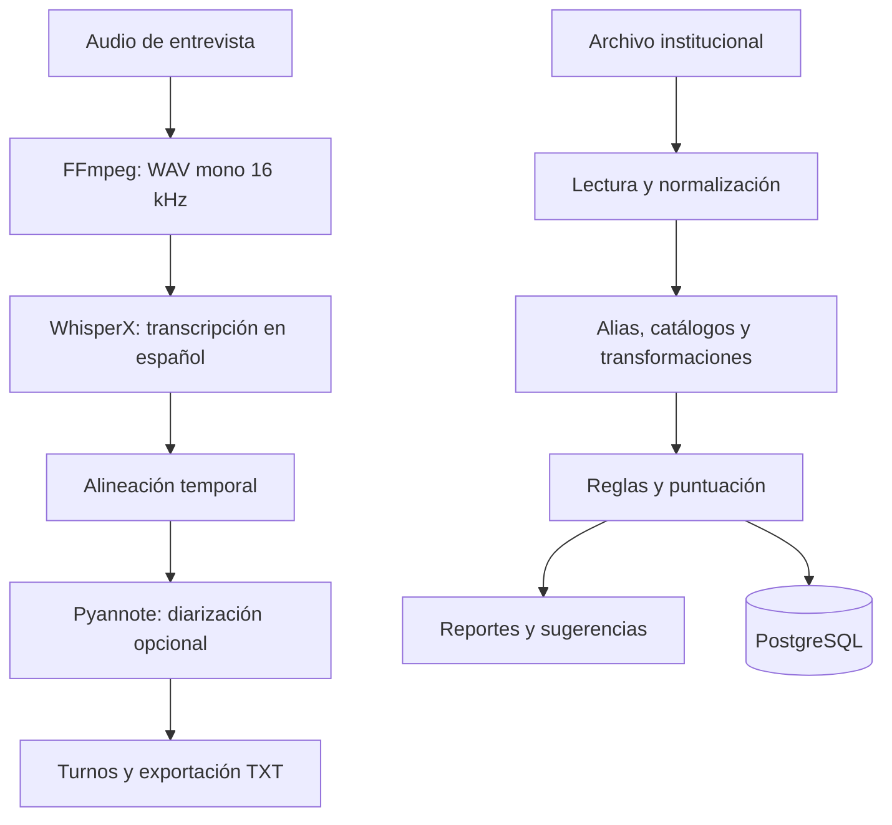
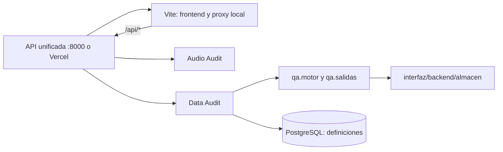

# Arquitectura del sistema

## Organización del repositorio

```text
/
├── audio-audit/
│   ├── app/
│   ├── static/
│   ├── .env.example
│   ├── requirements.txt
│   ├── README.md
│   └── start.bat
├── data-audit/
│   └── qa_bases_datos/
│       ├── .gitignore
│       ├── README.md
│       ├── schema.sql
│       └── backend/
├── interfaz/
│   ├── src/
│   ├── docs/API.md
│   ├── .env.example
│   └── vite.config.ts
├── documentation/
├── .gitignore
└── README.md
```

`main` contiene la estructura integrada del repositorio; `audio-audit`, `data-audit` y `documentation` son ramas de trabajo. La interfaz común está en interfaz/; la integración ejecutada de los motores sigue pendiente de comprobar.

## Flujos de procesamiento



## Audio Audit

FastAPI expone la interfaz estática y API local. `app/main.py` guarda archivos en `uploads/`, gestiona trabajos en memoria mediante un ejecutor de un trabajador y devuelve progreso y resultados. `app/transcriber.py` realiza preprocesamiento, inferencia y formación de turnos. El servidor arranca en 127.0.0.1:8000. El audio temporal se procesa en un directorio temporal; los originales cargados tienen un ciclo de limpieza limitado a trabajos terminados en la sesión. No existe persistencia de la cola confirmada.

## Data Audit

El backend documenta `qa/lector.py`, `definicion.py`, `transformaciones.py`, `codificador.py`, `reglas.py`, `motor.py`, `salidas.py`, `texto.py` y `cli.py`. Las configuraciones YAML describen bases, alias, catálogos y reglas. `scripts/cargar_config.py` carga definiciones y diccionarios en PostgreSQL; `scripts/comparar_con_ine.py` compara resultados con publicaciones. El esquema contiene 19 tablas según el README. La bitácora incluye cargas, ejecuciones, hallazgos, correcciones y exclusiones. La API (`qa/api.py`) registra cargas, ejecuciones y archivos en PostgreSQL; en el despliegue los archivos viven en Supabase Storage (`qa/almacenamiento.py`).

## Integración futura

La selección del rol encuestador y la auditoría de protocolos siguen sin comprobar. La navegación común ya está implementada en interfaz/.

## Interfaz común



El proxy existe en desarrollo y preview, no dentro de dist/. Ver [operación integrada](interfaz.md).
