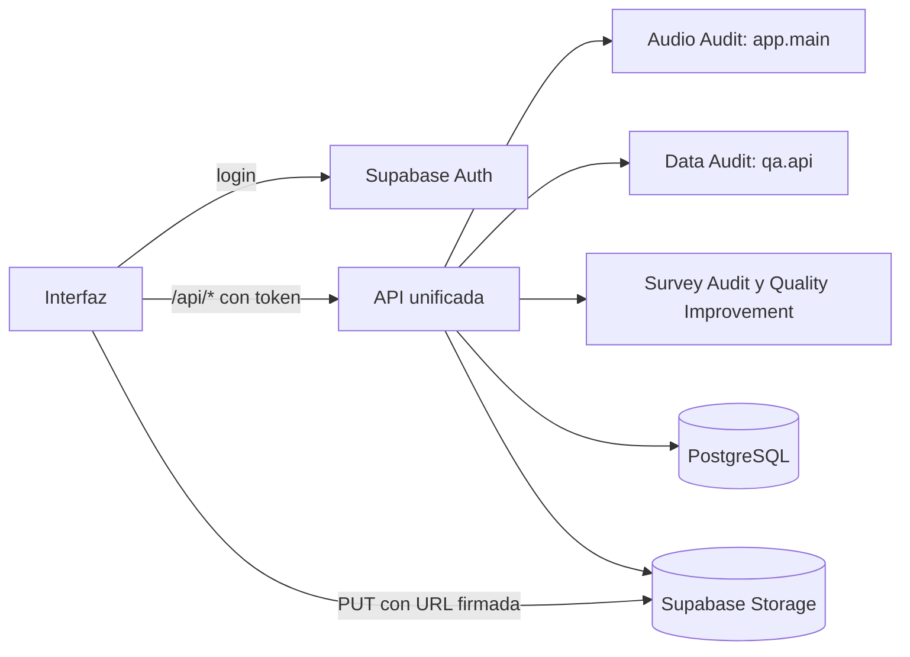

# API: convenciones y ejemplos

Una sola aplicación FastAPI (`api/index.py` → `plataforma/app.py`) atiende a los cuatro módulos. La lista completa de las **78 operaciones** (método, ruta, parámetros, validaciones y respuestas) está en la [referencia de la API](api-referencia.md), generada del esquema OpenAPI. En local, la documentación interactiva está en `http://127.0.0.1:8000/docs` (desactivada en producción).



| Prefijo | Módulo | Operaciones |
|---|---|---:|
| `/api/qa/*` | Data Audit | 22 |
| `/api/surveys/*` | Survey Audit | 22 |
| `/api/improvement/*` | Quality Improvement | 13 |
| `/api/jobs`, `/api/transcribe*`, `/api/storage/*`, `/api/rules`, `/api/calibration`, `/api/salud`… | Audio Audit y plataforma | 21 |

## Autenticación

- Con Supabase configurado, toda ruta salvo `/api/salud` exige la cabecera `Authorization: Bearer <access_token>` con el token de sesión de Supabase Auth. La interfaz la agrega sola.
- Sin Supabase (local), no hay token pero la API solo atiende peticiones a `localhost`/`127.0.0.1`.
- Las escrituras (`POST`, `PUT`, `PATCH`, `DELETE`) con cabecera `Origin` solo se aceptan desde el mismo origen.

## Formato de datos

- Peticiones y respuestas en JSON (UTF-8), salvo las subidas de archivos (cuerpo binario con `PUT` o `multipart/form-data`) y las descargas (archivo o `{"url": …}` firmada por 5 minutos).
- Fechas en ISO 8601. Identificadores: UUID en Data Audit y Audio Audit; cadenas aleatorias en Survey y QI.

## Errores

Todos los errores devuelven JSON con un mensaje en español pensado para mostrarse al usuario:

```json
{"detail": "El archivo supera el límite de 50 MB."}
```

Al finalizar una entrevista con respuestas inválidas, Survey Audit agrega la lista de errores:

```json
{"detail": "Hay 2 respuestas por corregir antes de finalizar.",
 "errores": [{"clave": "A3", "pregunta": "A3. ¿Cuántas horas al día tiene servicio de agua?", "mensaje": "El valor debe ser mayor o igual a 0 y menor o igual a 24."},
             {"clave": "C2#1", "pregunta": "Persona 1 · C2. ¿Cuántos años cumplidos tiene?", "mensaje": "Falta la respuesta."}]}
```

Los errores de validación de FastAPI (422) devuelven `detail` como lista de campos inválidos.

| Código | Significado | Ejemplos |
|---|---|---|
| 200 | Correcto | — |
| 400 | Petición incompleta | «El archivo está vacío.», «El archivo todavía no se ha subido.» |
| 401 | Sin sesión o sesión vencida | Falta el token |
| 403 | Acceso no permitido | Host distinto de `localhost` sin Supabase; «Origen no permitido.»; rutas de llaves bloqueadas |
| 404 | No existe | «Carga no encontrada.» |
| 409 | El estado no permite la acción | «La carga ya se está procesando.», «Primero vincula la transcripción de la entrevista.» |
| 413 | Archivo demasiado grande | Bases > 50 MB, transcripciones > 5 MB |
| 422 | Datos no válidos | Campos fuera de rango, entrevista con errores, reporte con formato desconocido, falta autorización de la grabación |
| 429 / 503 | Servicio externo ocupado o no configurado | IA ocupada (la interfaz reintenta); falta `ANTHROPIC_API_KEY` |

## Ejemplo 1: auditar una base (Data Audit)

Flujo en tres pasos: registrar → subir → procesar.

```http
POST /api/qa/cargas/subida
Content-Type: application/json

{"base": "EMERGENCIAS", "anio": 2025, "mes": 3, "archivo": "emergencias_sintetica.csv", "tamano": 2801}
```

```json
{"carga_id": "6f1c…", "base": "EMERGENCIAS", "max_bytes": 52428800,
 "subida": {"url": "<URL firmada de Supabase Storage o /api/qa/cargas/6f1c…/archivo>", "metodo": "PUT", "directa": true}}
```

Luego `PUT` del archivo a `subida.url` y:

```http
POST /api/qa/cargas/6f1c…/procesar
```

La respuesta es el reporte: puntaje global y por dimensión, total de registros, hallazgos, correcciones aplicadas y pendientes, excluidos y rutas de descarga (`/api/qa/cargas/{id}/descargar/corregido|bitacora|reporte|original`). Con lo aprobado en la bandeja, `POST /api/qa/cargas/{id}/reprocesar` genera una nueva versión.

## Ejemplo 2: decidir una sugerencia

```http
POST /api/qa/sugerencias/{correccion_id}/aprobar
Content-Type: application/json

{"codigo": "0108"}
```

Sin `codigo` se aprueba el valor sugerido; con `codigo` se aprueba otro código del catálogo (buscado con `GET /api/qa/catalogos/{catalogo}?q=mixco`). Para rechazar: `POST /api/qa/sugerencias/{correccion_id}/rechazar` con `{"comentario": "El municipio no corresponde al departamento"}`. La decisión sobre la base completa usa `POST /api/qa/cargas/{id}/aprobar` o `/rechazar` con `{"comentario": "…"}`.

## Ejemplo 3: Survey Audit

```http
POST /api/surveys/interviews
{"template_id": "<formulario finalizado>", "nombre": "Hogar 15"}

PATCH /api/surveys/interviews/{id}
{"responses": {"A1": "1", "A2": "1", "A3": 30, "_personas": 1}, "revision": 1}

POST /api/surveys/interviews/{id}/submit        → 422 con "errores" (A3 fuera de 0–24)
```

## Ejemplo 4: Quality Improvement

```http
POST /api/improvement/reports
{"report": { …contenido de reporte.json… }, "archivo": "reporte.json"}
```

```json
{"institucion": "SECONRED", "base": "EMERGENCIAS", "periodo": "Marzo 2025",
 "nuevas": 5, "actualizadas": 0, "con_ia": false, "recomendaciones": [ … ]}
```

## Ejemplo 5: estado del servicio

```http
GET /api/salud
```

```json
{"ok": true, "login": true, "entorno": "vercel"}
```

## Reglas de integración

- El vínculo entre una entrevista y su transcripción se guarda por identificador de entrevista y huella del contenido, no por nombre de archivo.
- La verificación con la grabación nunca cambia las respuestas registradas.
- Data Audit no se conecta automáticamente con Quality Improvement: se descarga `reporte.json` y se sube (mejora pendiente).
- Las llaves de proveedores nunca viajan desde el navegador: solo se configuran en el servidor.
