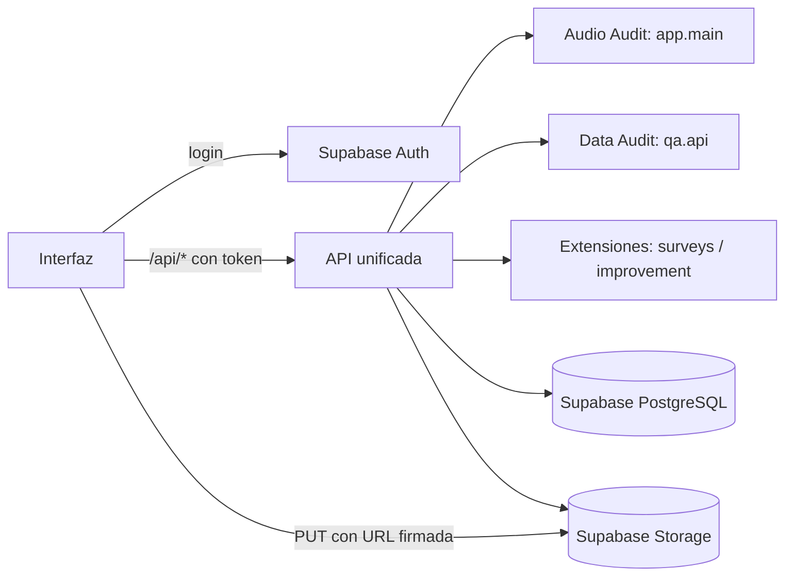

# Conexión de API

Una interfaz Vite y una **API unificada** (`api/index.py` → `plataforma/app.py`) que monta en un solo FastAPI las rutas de Audio Audit, Data Audit y las extensiones. En producción ambas viven en el mismo proyecto de Vercel; ver [despliegue](deployment.md).



## Rutas y contratos

| Ruta desde navegador | Destino | Contrato |
|---|---|---|
| `/api/storage/upload-url` → `/api/transcribe/cloud` | Audio Audit | URL firmada, subida directa y transcripción en la nube; retorna job_id |
| `/api/transcribe` | Audio Audit | Multipart (local con WhisperX); retorna job_id |
| `/api/jobs/{id}` | Audio Audit | Polling de progreso y resultado |
| `/api/qa/bases` | Data Audit | Catálogo disponible |
| `/api/qa/cargas/subida` → `/api/qa/cargas/{id}/procesar` | Data Audit | Registro, subida y validación; retorna reporte y descargas |
| `/api/surveys/documents` → `/preparar` → `/leer` → `/formulario` | Survey Audit | Subida del PDF, lectura por bloques de páginas con Claude y armado del formulario |
| `/api/surveys/templates` | Survey Audit | Formularios: revisión, edición y finalización |
| `/api/surveys/interviews` | Survey Audit | Entrevistas con código único, captura y finalización con validación |
| `/api/surveys/interviews/{id}/transcripts` y `/encuestador` | Survey Audit | JSON de Audio Audit con autorización y hablante del encuestador |
| `/api/surveys/interviews/{id}/verificacion` y `/findings/{id}` | Survey Audit | Comparación con la grabación y revisión de resultados |
| `/api/improvement/reports` | Quality Improvement | reporte.json de Data Audit |
| `/api/improvement/recommendations` | Quality Improvement | Edición, aprobación con cargo y descarte |
| `/api/improvement/manuals` | Quality Improvement | Borrador editable, finalización y PDF |

La interfaz existente procesa audio por su cliente original. En Survey Audit se importa el JSON descargado de Audio Audit («Descargar JSON»). Quality Improvement importa reporte.json; tampoco se envía automáticamente el resultado de Data Audit.

El vínculo se guarda por UUID de entrevista, no por nombre de archivo. No se transmiten tokens HF al módulo de encuestas. La verificación con la grabación nunca cambia las respuestas registradas en el formulario.

## Inicio local

Ver [instalación y operación integrada](interfaz.md#procesamiento-real-api-unificada). Resumen, desde la raíz:

```powershell
python -m venv .venv
.\.venv\Scripts\python.exe -m pip install -r requirements.txt
.\.venv\Scripts\python.exe -m uvicorn api.index:app --port 8000 --reload
```

Y desde `interfaz`: `npm ci` y `npm run dev`. Documentación interactiva de la API: `http://127.0.0.1:8000/docs` (desactivada en Vercel).

Para probar las extensiones solo con material sintético, establecer `QA_STORAGE=demo` en `.env`; guarda su estado en `interfaz/backend/almacen/extensions.demo.json`.

## Límites actuales y evolución

- El formulario generado desde el PDF debe revisarse antes de finalizarlo; la lectura con IA puede equivocarse en tablas complejas.
- PostgreSQL usa un agregado JSONB transaccional en esquema separado. Adecuado para piloto; normalizar entidades y paginar antes de alta concurrencia.
- Autenticación con Supabase Auth en la API unificada; todavía no hay roles ni permisos por institución.
- Las tasas no se calculan sin confirmar unidad de conteo; no se suman hallazgos como personas únicas.
- Manual en PDF. Aprobación técnica no equivale a validación del INE.
- Las pruebas con archivo de demo no certifican PostgreSQL, GPU ni los motores reales.

Despliegue: interfaz y API en un proyecto de Vercel; PostgreSQL, Auth y archivos privados en un proyecto de Supabase. Ver [despliegue](deployment.md).
