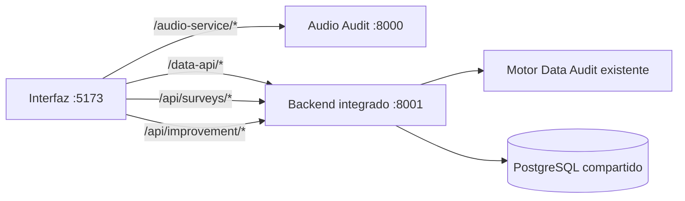

# Conexión de API

Una interfaz Vite, un backend integrado y el servicio de audio existente. Los directorios `audio-audit` y `data-audit` conservan el contenido original.



## Rutas y contratos

| Ruta desde navegador | Destino | Contrato |
|---|---|---|
| `/audio-service/api/transcribe` | `:8000/api/transcribe` | Multipart; retorna job_id |
| `/audio-service/api/jobs/{id}` | `:8000/api/jobs/{id}` | Polling de progreso y resultado |
| `/data-api/bases` | `:8001/data-api/bases` | Catálogo disponible |
| `/data-api/procesar` | `:8001/data-api/procesar` | Archivo, base, año y mes |
| `/api/surveys/templates` | `:8001/api/surveys/templates` | Instrumentos y versiones |
| `/api/surveys/interviews` | `:8001/api/surveys/interviews` | Captura y persistencia |
| `/api/surveys/interviews/{id}/transcripts` | Backend integrado | Resultado autorizado de Audio Audit |
| `/api/surveys/interviews/{id}/reconcile` | Backend integrado | Pregunta, intervenciones, encuestador y valor observado |
| `/api/improvement/reports` | Backend integrado | reporte.json de Data Audit y metadatos de origen |
| `/api/improvement/manuals` | Backend integrado | Borradores, aprobación técnica y descarga |

La interfaz existente procesa audio por su cliente original. En Survey Audit se importa el resultado JSON autorizado; la transferencia automática desde la pantalla Audio Audit sigue pendiente. Quality Improvement importa reporte.json; tampoco se envía automáticamente el resultado de Data Audit.

El vínculo se guarda por UUID de entrevista, no por nombre de archivo. No se transmiten tokens HF al módulo de encuestas. La conciliación actual requiere alineación humana y conserva la respuesta original.

## Inicio local

Instalar Python y las dependencias del motor de datos según su README. Desde la raíz:

```powershell
python -m venv .venv
.\.venv\Scripts\python.exe -m pip install -r data-audit/qa_bases_datos/backend/requirements.txt -r interfaz/backend/requirements-extensions.txt
```

Configurar `interfaz/.env` a partir de `.env.example`, con `VITE_APP_MODE=api`. Para PostgreSQL establecer `DATABASE_URL` y ejecutar la migración aditiva `interfaz/backend/migrations/001_extensions.sql` con el rol propietario. No reemplaza el esquema del motor.

Para probar únicamente con material sintético, establecer `QA_STORAGE=demo` en ese `.env`. Guarda las extensiones en `interfaz/backend/almacen/extensions.demo.json`; Data Audit sigue requiriendo su PostgreSQL original.

Terminal 1, desde `interfaz/backend`:

```powershell
..\..\..\.venv\Scripts\python.exe -m uvicorn main:app --host 127.0.0.1 --port 8001
```

Terminal 2: iniciar Audio Audit con las instrucciones originales y puerto 8000.

Terminal 3, desde `interfaz`:

```powershell
npm.cmd ci
npm.cmd run dev
```

Abrir la dirección local mostrada por Vite. Documentación interactiva del backend: `http://127.0.0.1:8001/docs`.

## Límites actuales y evolución

- Piloto de encuesta sintético. El constructor visual completo y las reglas ENCOVI verificadas todavía no están integrados.
- El PDF extrae texto por página para revisión; no publica preguntas automáticamente ni hace OCR.
- PostgreSQL usa un agregado JSONB transaccional en esquema separado. Adecuado para piloto; normalizar entidades y paginar antes de alta concurrencia.
- No hay autenticación ni permisos de producción en estas extensiones. Ejecutar solo en loopback por ahora.
- Las tasas no se calculan sin confirmar unidad de conteo; no se suman hallazgos como personas únicas.
- Manual descargable Markdown. Aprobación técnica no equivale a validación del INE.
- Las pruebas con archivo de demo no certifican PostgreSQL, GPU ni los motores reales.

Despliegue futuro: interfaz en Vercel, PostgreSQL/Auth/archivos privados en Supabase y Python en servicio compatible con modelos y FFmpeg. Las rutas relativas requieren un reverse proxy de producción; la configuración de Vite solo cubre desarrollo y preview. No hay despliegue realizado.
