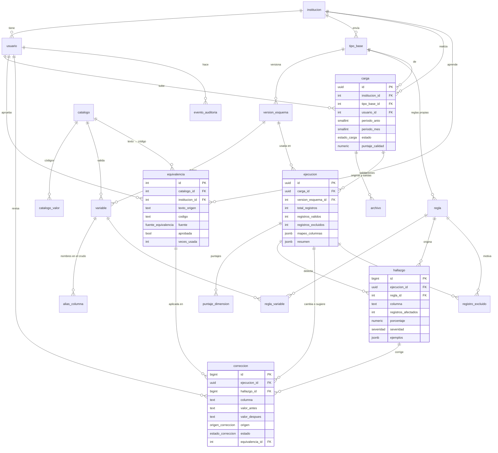
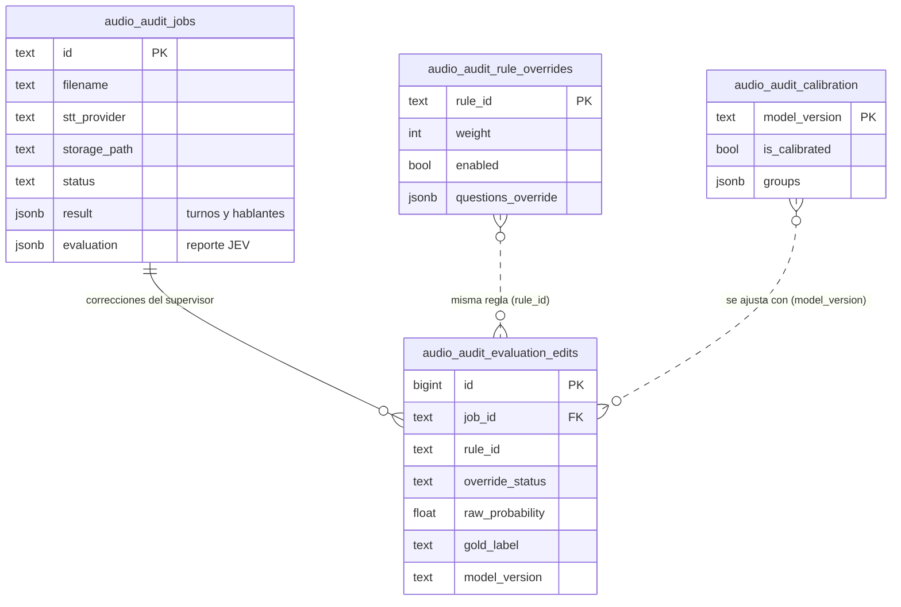
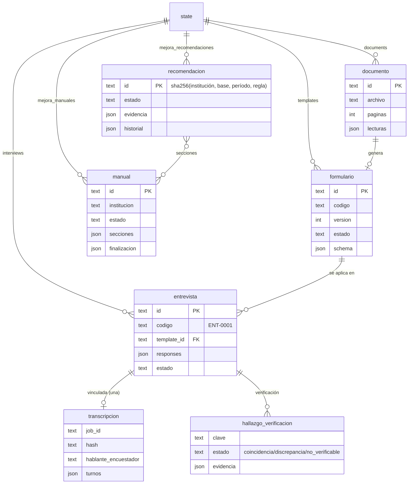

# Modelo de datos y persistencia

Quality Audit guarda su información en tres lugares, según la naturaleza del dato:

| Dónde | Qué se guarda | Por qué ahí |
|---|---|---|
| **PostgreSQL** (Supabase) | Configuración de bases, catálogos y reglas. Cargas, ejecuciones, puntajes, hallazgos, correcciones, equivalencias aprobadas y bitácora de auditoría. Trabajos de audio con su transcripción y evaluación, reglas JEV editadas y calibración. Formularios, entrevistas, recomendaciones y manuales | Datos estructurados que se consultan, filtran y relacionan |
| **Almacenamiento de archivos** (Supabase Storage, privado) | Bases originales y sus salidas (corregido, bitácora, reporte); grabaciones; cuestionarios en PDF | Archivos grandes con datos personales: fuera de tablas consultables y accesibles solo con URL firmada |
| **Memoria** (temporal) | Avance de un proceso en curso, caché de PDF y de tablas durante una petición, sesión del navegador | No necesita sobrevivir a la petición o a la sesión |

**Decisión clave:** los registros individuales de las bases institucionales (filas con CUI, nombres o direcciones) **no se guardan en PostgreSQL**. Solo se guardan en el archivo original (almacenamiento privado) y en la base corregida, ya sin columnas personales. En la base de datos quedan metadatos, conteos, reglas aplicadas y, en las correcciones, el valor antes y después de una celda de catálogo, con su fila de referencia.

## Diagrama entidad-relación

### Data Audit (esquema `public`, 19 tablas)

### Audio Audit (esquema `public`, 4 tablas)

### Survey Audit y Quality Improvement (esquema `quality_extensions`)

Estos módulos guardan su estado en **un documento JSONB** (`quality_extensions.state`, una sola fila con `id = 1`). Cada escritura se hace en una transacción con `SELECT … FOR UPDATE`, y la columna `revision` permite detectar ediciones simultáneas. Se eligió así por la velocidad de desarrollo del prototipo. Para alta concurrencia se propone normalizarlo en tablas por entidad ([mejoras](limitaciones.md)).

## Descripción de las tablas

### Configuración (se carga con `scripts/cargar_config.py`)

| Tabla | Contenido | Llaves e integridad |
|---|---|---|
| `institucion` | Instituciones que envían datos (RENAP, PNC, INSIVUMEH, SECONRED) | PK `id`; `siglas` única |
| `usuario` | Personas que usan el sistema; se crean al primer inicio de sesión con el correo de Supabase Auth | PK `id`; `email` único; CHECK: el rol `institucion` exige `institucion_id` |
| `tipo_base` | Las 5 bases soportadas | PK `id`; `codigo` único; FK a `institucion` |
| `version_esquema` | Versión de la estructura de cada base y su formato de crudo (JSONB) | PK `id`; única (`tipo_base_id`, `version`); índice único parcial: **una sola versión activa por base** |
| `variable` | Columnas publicadas por el INE: tipo, catálogo, obligatoriedad, rango, patrón, si es dato personal y transformación | PK `id`; única (`version_esquema_id`, `nombre_ine`); FK a `catalogo` |
| `alias_columna` | Otros nombres con que llega cada columna en los crudos | Única (`variable_id`, `alias`); borrado en cascada |
| `catalogo`, `catalogo_valor` | 31 catálogos y sus códigos oficiales, con código padre (municipio → departamento, causa → grupo) | Única (`catalogo_id`, `codigo`); índice por etiqueta en minúsculas para búsquedas |
| `regla`, `regla_variable` | 33 reglas con dimensión, severidad, acción y parámetros (JSONB) editables sin programar | `codigo` único; PK compuesta en `regla_variable` |
| `equivalencia` | **Correcciones guardadas**: texto de origen → código, por institución, con fuente (diccionario, manual o IA), quién la aprobó y cuántas veces se usó | Única `NULLS NOT DISTINCT` (`catalogo_id`, `institucion_id`, `texto_origen`): no hay dos equivalencias para el mismo texto |

### Operación

| Tabla | Contenido | Llaves e integridad |
|---|---|---|
| `carga` | Un envío: institución, base, período, usuario, estado (`recibida` → `procesando` → `con_observaciones` / `aprobada` / `rechazada` / `error`) y puntaje | PK UUID; CHECK mes 1-12; índice por institución, base y período |
| `archivo` | Original y salidas de cada carga con su tamaño, **SHA-256** y ruta (`supabase://bucket/objeto` o ruta local) | FK a `carga` |
| `ejecucion` | Cada validación de una carga (la primera y los reprocesos): conteos, mapeo de columnas y resumen | FK a `carga` y `version_esquema` |
| `puntaje_dimension` | Puntaje 0-100 por dimensión de cada ejecución | PK (`ejecucion_id`, `dimension`) |
| `hallazgo` | Cada problema detectado: regla, columna, hoja, registros afectados, porcentaje, mensaje y ejemplos de filas | FK a `ejecucion` y `regla`; índice por ejecución y severidad |
| `correccion` | Cada cambio aplicado o sugerido: valor antes y después, origen, confianza, justificación, estado, quién lo revisó | FK a `ejecucion`, `hallazgo`, `equivalencia` y `usuario`; índice parcial de pendientes |
| `registro_excluido` | Registros fuera de la base publicable, con regla, motivo y filas | FK a `ejecucion` y `regla` |
| `evento_auditoria` | Bitácora de acciones: subir, reprocesar, aprobar, rechazar, descargar el original, quitar una equivalencia | FK a `usuario` |

### Audio Audit

| Tabla | Contenido |
|---|---|
| `audio_audit_jobs` | Cada transcripción: archivo, proveedor, ruta del audio en Storage, estado y avance, **turnos con tiempos y hablantes** (`result`) y la **evaluación JEV** completa (`evaluation`) |
| `audio_audit_rule_overrides` | Reglas JEV reescritas por el supervisor: texto, peso (CHECK 1-3), activa o no, guía para el auditor y preguntas editadas |
| `audio_audit_evaluation_edits` | Cada corrección del supervisor: resultado anterior y nuevo, comentario, ventana, y para la calibración la probabilidad cruda, la etiqueta correcta y la versión del modelo. Índice por trabajo y por grupo de calibración |
| `audio_audit_calibration` | Parámetros de calibración ajustados por versión de modelo (Platt y temperatura) con sus métricas |

El detalle completo (columnas, tipos, nulos, valores por defecto, restricciones e índices) se generó desde el catálogo de PostgreSQL: [modelo-datos-tablas.md](modelo-datos-tablas.md).

## Almacenamiento de archivos

| Bucket privado | Contenido | Ruta | Quién escribe |
|---|---|---|---|
| `qa-cargas` | `original.<ext>`, `corregido.xlsx`, `bitacora.xlsx`, `reporte.json` | `cargas/<carga_id>/…` | El navegador sube el original con URL firmada; la API escribe las salidas |
| `audio-interviews` | Grabaciones de entrevistas | `jobs/<job_id>/<archivo>` | El navegador, con URL firmada |
| `encuestas` | Cuestionarios en PDF | `cuestionarios/<documento_id>.pdf` | El navegador, con URL firmada (el bucket se crea solo si no existe) |

Las descargas devuelven una URL firmada que vence en 5 minutos. Sin Supabase (modo local), los mismos archivos quedan en carpetas locales ignoradas por Git: `data-audit/qa_bases_datos/almacen/`, `interfaz/backend/almacen/encuestas/` y `audio-audit/uploads/`.

## Lo que queda en memoria

| Dato | Dónde | Duración |
|---|---|---|
| Avance de una validación o transcripción en curso | Memoria del proceso (local) o la propia petición (Vercel) | Hasta que termina. Si se reinicia el servidor local se pierde la barra de avance, no los resultados |
| Archivo de la base durante la validación | `/tmp` de la función | La petición |
| Páginas de un PDF ya leídas | `/tmp/encuestas-cache` | Mientras la función esté activa |
| Sesión del usuario | Navegador (supabase-js) | Hasta cerrar sesión o vencer el token |
| Grabación recién transcrita | Memoria del navegador (para reproducirla) | La pestaña abierta |

## Migraciones

El esquema se crea en este orden con `supabase/configurar.py`. Todos los pasos se pueden repetir sin borrar datos:

1. `data-audit/qa_bases_datos/schema.sql`: tablas y tipos de Data Audit (solo si no existen).
2. `audio-audit/supabase/schema.sql`: tablas de Audio Audit y bucket. Usa `CREATE … IF NOT EXISTS` y `ALTER TABLE … ADD COLUMN IF NOT EXISTS`, por ejemplo para las columnas de calibración agregadas después.
3. `interfaz/backend/migrations/001_extensions.sql`: esquema `quality_extensions` y su fila de estado.
4. `supabase/seguridad.sql`: buckets privados, RLS en todas las tablas y permisos solo para el rol de servidor.

Después, `scripts/cargar_config.py` carga instituciones, bases, variables, alias, catálogos (desde los diccionarios del INE) y reglas. Vuelve a correrse cuando cambia un YAML: actualiza sin duplicar.
