# Manual de usuario

Guía para el personal técnico del INE y de las instituciones. No se necesitan conocimientos de programación. Todas las imágenes muestran **datos sintéticos**; los archivos de ejemplo están en la carpeta `documentation/ejemplos/` del repositorio para que cualquier persona repita cada paso.

## 1. Entrar a la plataforma

1. Abrir **https://dataton-six.vercel.app** en Chrome, Edge o Firefox actualizados.
2. Escribir el correo y la contraseña asignados (ver [accesos](accesos.md)) y pulsar **Entrar**. No existe registro público: las cuentas las crea el administrador.
3. Para salir, pulsar **Cerrar sesión** (arriba a la derecha). La sesión también se cierra sola al vencer; basta con volver a entrar.

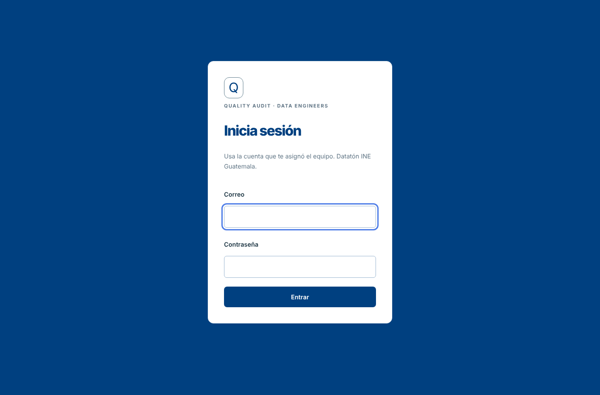

## 2. Navegación

El menú de la izquierda tiene cinco opciones. **Vista general** muestra los cuatro módulos, cada uno con su descripción y un botón para empezar: **Evaluar una entrevista** (Audio Audit), **Auditar una base** (Data Audit), **Crear un formulario** (Survey Audit) y **Generar recomendaciones** (Quality Improvement).

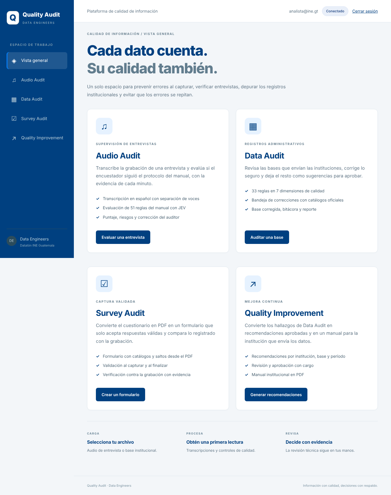

| Módulo | Para qué sirve | Archivos que acepta |
|---|---|---|
| **Audio Audit** | Transcribir una entrevista y evaluar si el encuestador siguió el protocolo | Audio MP3, WAV, M4A, OGG, FLAC, AAC, OPUS o WEBM (hasta 50 MB); transcripción JSON o TXT (hasta 5 MB) |
| **Data Audit** | Revisar y corregir una base enviada por una institución | XLSX, XLS o CSV (hasta 50 MB) |
| **Survey Audit** | Convertir un cuestionario PDF en un formulario que valida las respuestas, y compararlas con la grabación | PDF (hasta 50 MB); JSON descargado de Audio Audit |
| **Quality Improvement** | Convertir los hallazgos en recomendaciones y un manual para la institución | Reporte JSON descargado de Data Audit |

Los cuatro módulos se conectan: el JSON de Audio Audit alimenta a Survey Audit y el reporte de Data Audit alimenta a Quality Improvement.

---

## 3. Data Audit: revisar una base institucional

**Ejemplo para practicar:** `documentation/ejemplos/emergencias_sintetica.csv` (41 emergencias inventadas con errores a propósito).

### 3.1 Iniciar la auditoría

1. Ir a **Data Audit**.
2. En **Base institucional** elegir la base (p. ej., *Emergencias y desastres · SECONRED*).
3. Indicar **Año de referencia** y **Mes** del período que se entrega (ejemplo: 2025, marzo).
4. Seleccionar el archivo y pulsar **Auditar base**. Una base de miles de registros tarda unos segundos.

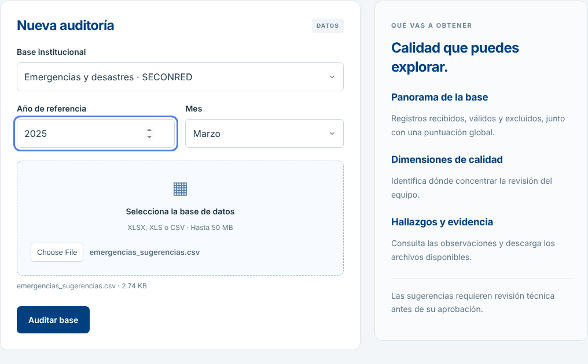

No hace falta arreglar el archivo antes: el sistema encuentra solo la fila de encabezados aunque haya títulos encima, reconoce nombres de columna distintos y une hojas mensuales.

### 3.2 Leer el resultado

Al terminar se abre el detalle:

- **Puntaje global** (0 a 100) y **registros recibidos, válidos y excluidos**.
- **Dimensiones de calidad** con su barra: verde (bien), amarillo (atención), rojo (revisar primero). Ejemplo: completitud 67.3 indica muchos datos faltantes.
- **Archivos guardados**: *archivo original* (tiene datos personales; su descarga queda registrada), *base corregida* (formato del INE, sin datos personales ni registros excluidos), *bitácora de cambios* (Excel con todo lo que se cambió y por qué) y *reporte JSON* (para Quality Improvement).

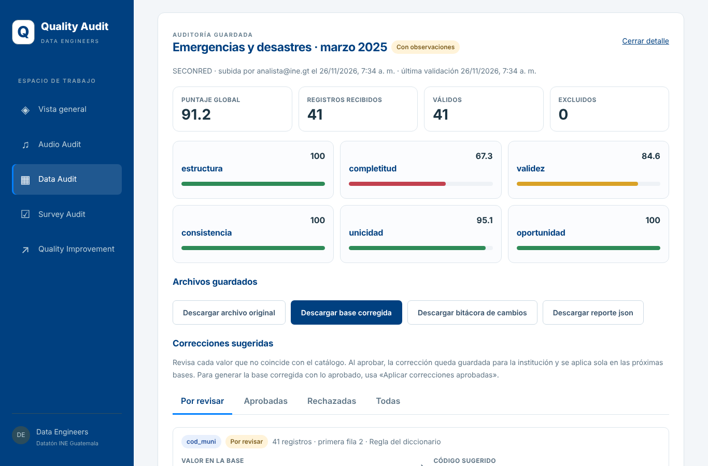

### 3.3 Revisar los hallazgos

La tabla de hallazgos explica cada problema en lenguaje claro, con la columna, cuántos registros afecta y su severidad (*error*, *advertencia*, *informativo*). Se puede filtrar por severidad. Abajo aparecen los **registros excluidos** con su motivo (por ejemplo, defunciones de otro año).

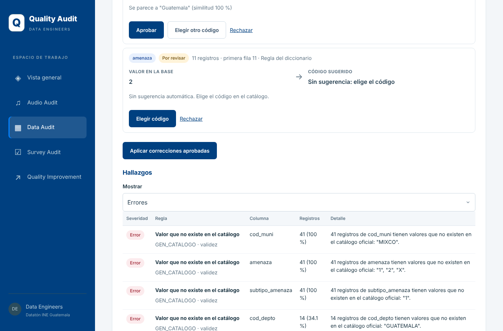

### 3.4 Corregir datos (bandeja de correcciones)

Cada valor que no coincide con el catálogo oficial aparece en **Correcciones sugeridas**, pestaña *Por revisar*. Para cada uno:

- **Aprobar** la sugerencia (p. ej., «Mixcoo» → 0108 Mixco).
- **Elegir otro código**: buscar en el catálogo por código o texto. También sirve cuando no hubo sugerencia.
- **Rechazar** con un motivo. Un valor rechazado no se vuelve a proponer.

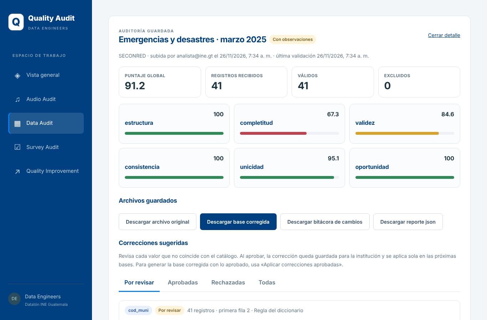
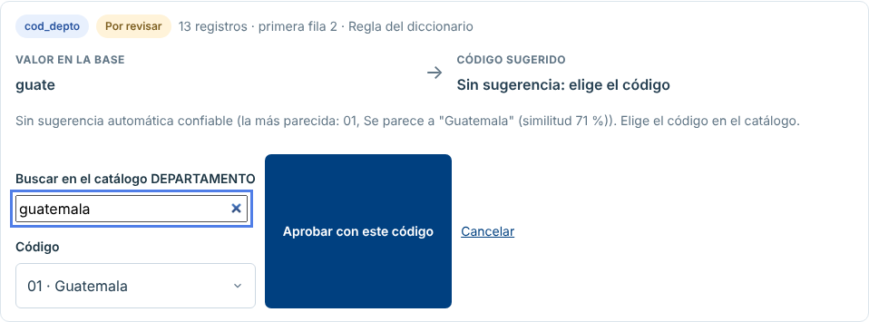

Después pulsar **Aplicar correcciones aprobadas**: el sistema vuelve a validar el mismo archivo y genera una base corregida nueva (el puntaje sube). Lo aprobado queda guardado para esa institución y **se aplica solo en las siguientes bases**.

Para cerrar, registrar la **decisión técnica** (aprobar o rechazar la base) con un comentario.

### 3.5 Historial y correcciones guardadas

- **Bases subidas**: todas las auditorías, filtrables por base y estado; se puede volver a abrir cualquiera.
- **Correcciones guardadas**: las equivalencias aprobadas por institución; se pueden buscar y quitar si alguna fue un error.

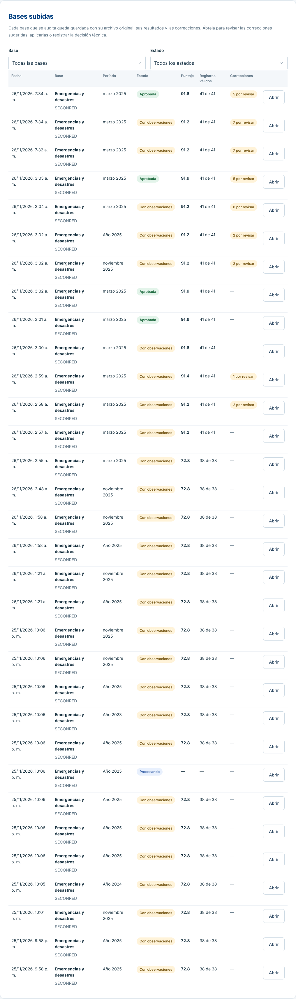
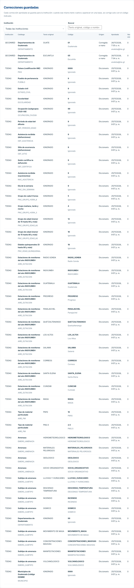

---

## 4. Audio Audit: supervisar una entrevista

**Ejemplo para practicar:** `entrevista_encovi_sintetica.json` (entrevista ENCOVI sintética con incumplimientos sembrados), cargado desde **¿Ya tienes la transcripción?**.

### 4.1 Transcribir una grabación

1. Ir a **Audio Audit** → **Nueva transcripción** y seleccionar el audio.
2. Elegir el **modelo de transcripción** y el **número de hablantes** (o *Detectar automáticamente*). Marcar **Identificar hablantes** para separar las voces.
3. Pulsar el botón de transcribir y esperar; el avance se muestra en pantalla.

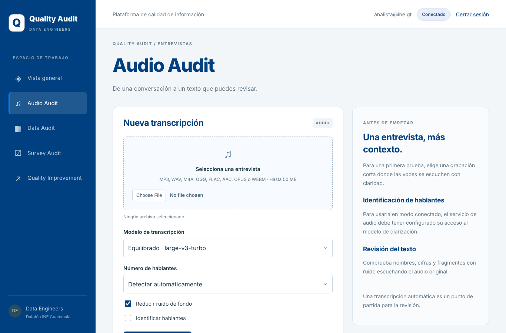

Si ya se tiene la transcripción, usar **¿Ya tienes la transcripción? → Cargar transcripción** (JSON o TXT con `HABLANTE: texto`).

### 4.2 Asignar roles y evaluar

1. En **Evaluar la entrevista con JEV**, indicar qué voz es *Encuestador(a)*, *Informante* u *Otra persona*. Debajo de cada voz se muestran sus primeras frases para reconocerla.
2. Marcar **Primera visita / contacto inicial** si se deben evaluar las reglas de apertura.
3. Pulsar **Evaluar con JEV**. La evaluación tarda de segundos a unos minutos según la duración de la entrevista.

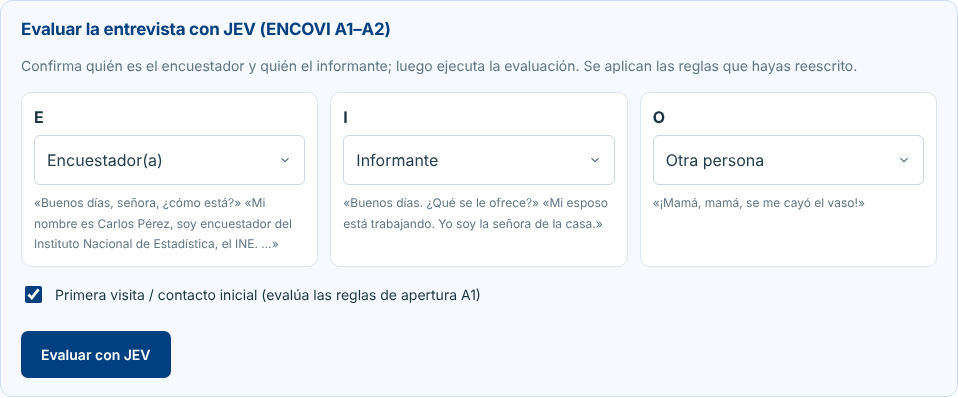

### 4.3 Interpretar el resultado

- **Veredicto**: *Cumplimiento alto*, *Aceptable con observaciones*, *Requiere revisión prioritaria* o *Sin evidencia suficiente*.
- **Cumplimiento global** y por sección (A1 Apertura y contacto inicial, A2 Conducta y actitud), **cobertura** (cuántas reglas se pudieron evaluar) y **conducta marcada por hora**.
- **Principales riesgos**: cada uno con la regla, la probabilidad de incumplimiento, el minuto y la frase de la grabación que lo respalda.
- **Todas las evaluaciones (51 reglas)** con filtros: incumplidas, a revisar, cumplidas, no aplica.

Las capturas de esta sección se tomaron en el entorno de pruebas con un cliente JEV de prueba (indicado en la línea «Modelo»), sin consumir la API.

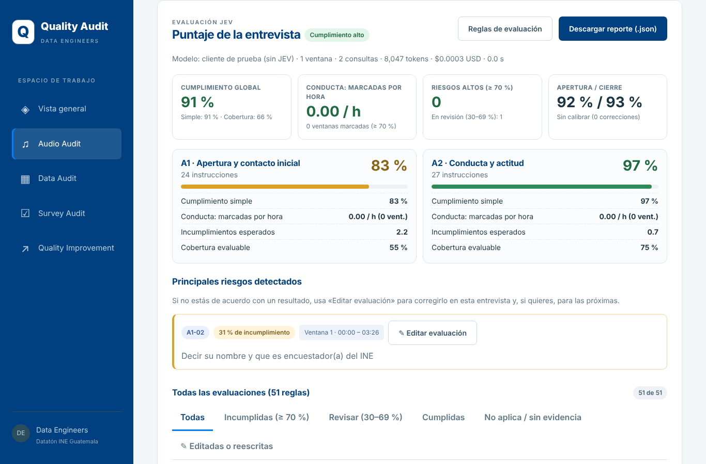
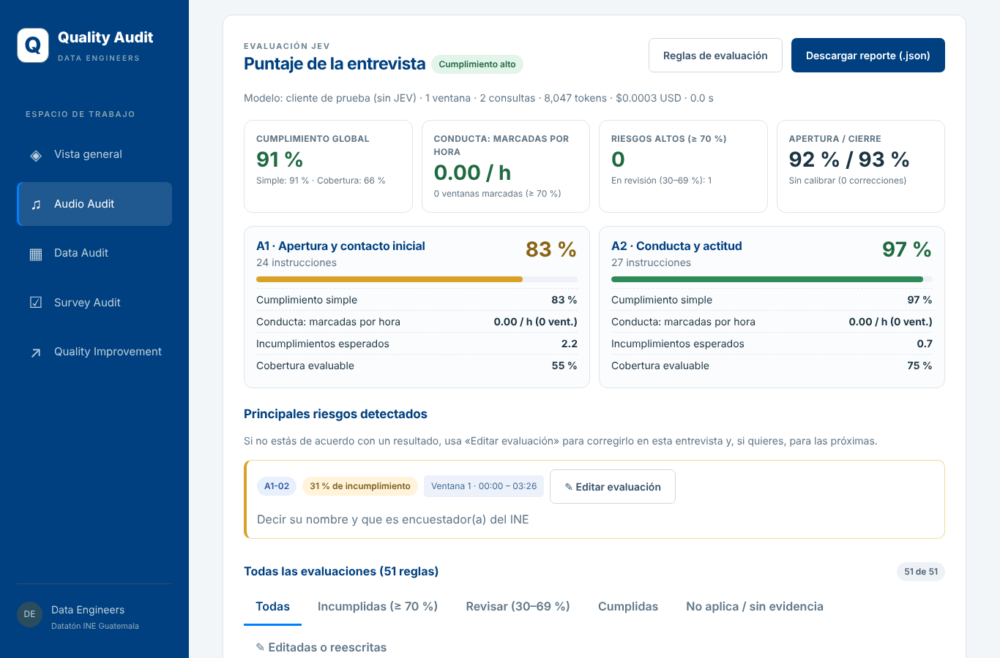
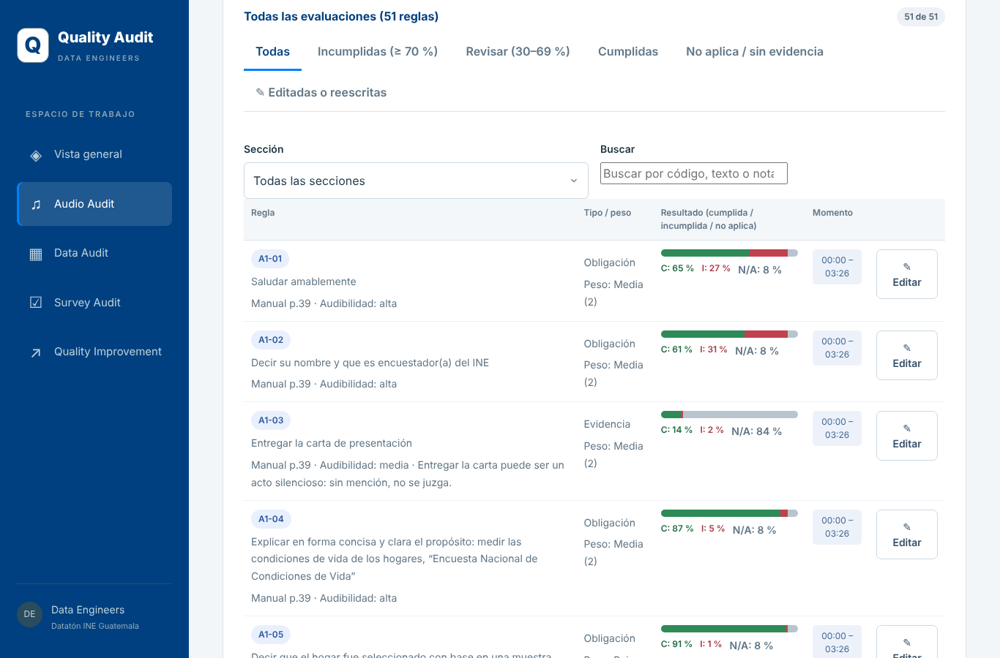

### 4.4 Corregir una evaluación

Si el auditor no está de acuerdo, **Editar evaluación** permite marcarla como cumplida, incumplida o no aplica, con una nota. El puntaje se recalcula y la regla queda marcada como corregida manualmente. Opcionalmente se puede reescribir el criterio para las próximas entrevistas (**Reglas de evaluación**).

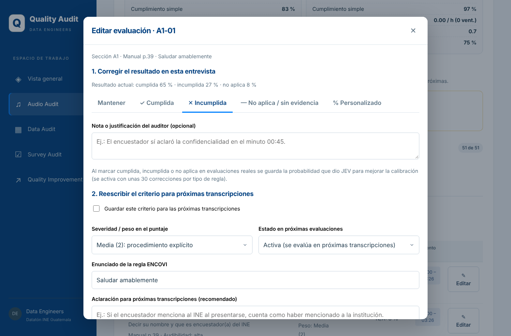

Con suficientes correcciones (unas 30 por tipo de regla) se activa la **calibración**, que ajusta las probabilidades a los criterios del INE.

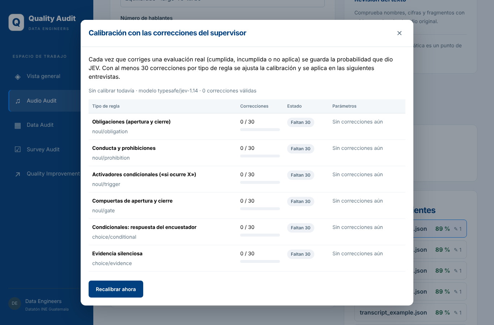

Descargas: **Descargar TXT**, **Descargar JSON** (para Survey Audit) y **Descargar reporte (.json)**.

---

## 5. Survey Audit: captura validada y conciliación

**Ejemplos para practicar:** `cuestionario_sintetico.pdf` y `transcripcion_sintetica.json`.

### 5.1 Convertir el cuestionario en formulario

1. Ir a **Survey Audit** → **Nueva entrevista**, escribir un nombre y seleccionar el PDF.
2. Pulsar **Generar formulario de entrevista**. Se leen todas las páginas, también las escaneadas. Un cuestionario largo (p. ej., 72 páginas) tarda varios minutos: **no cerrar la página** mientras se lee. Si una página no se puede leer, aparece un aviso para completarla a mano.

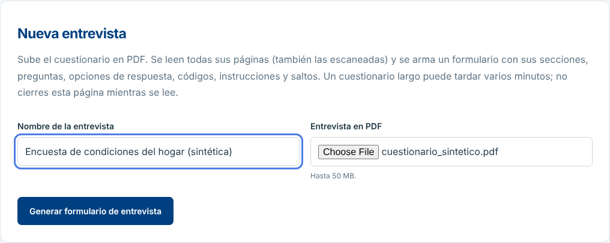

3. **Revisar y editar el formulario**: textos, tipo de respuesta, opciones con sus códigos, saltos («pase a») y rangos. La lectura automática puede equivocarse; esta revisión es obligatoria.
4. Pulsar **Finalizar formulario**. Solo un formulario finalizado admite entrevistas.

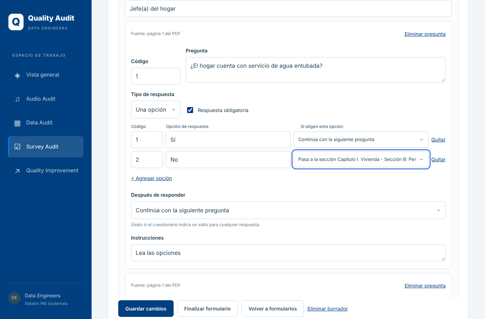

### 5.2 Capturar una entrevista

1. **Crear entrevista** con un código único.
2. Indicar el **Número de personas del hogar**: las secciones por persona se repiten automáticamente.
3. Responder. Las preguntas que un salto deja sin aplicar se ocultan solas.
4. **Guardar avance** en cualquier momento; **Finalizar entrevista** al terminar. Si hay errores (falta una respuesta, un valor fuera de rango, una opción que no existe), se listan y cada uno lleva a su pregunta.

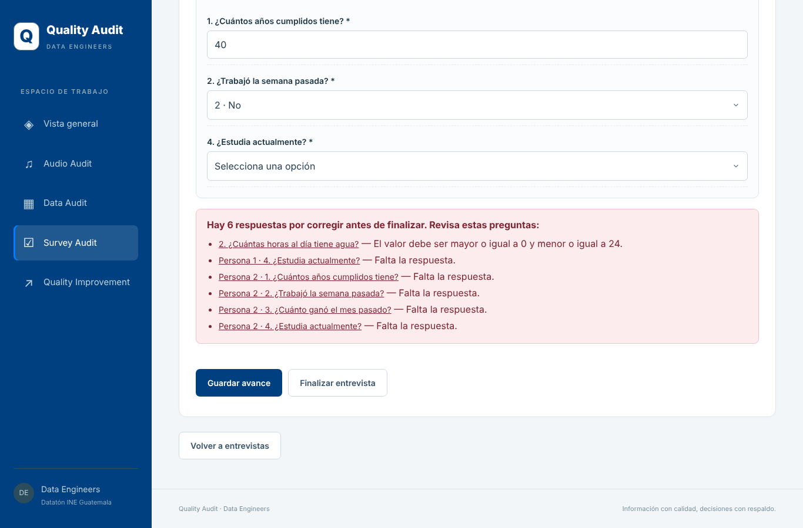

### 5.3 Compararla con la grabación

1. En **Grabación**, **Vincular transcripción de la entrevista**: seleccionar el JSON descargado de Audio Audit y marcar la casilla de autorización para usar la grabación.
2. Elegir qué hablante es el encuestador (**Guardar encuestador**).
3. Pulsar **Validar contra la grabación**.

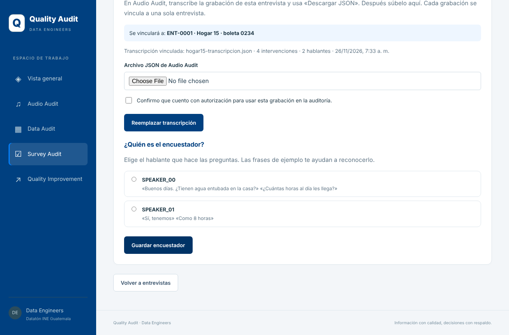

Cada respuesta queda como **Coincide**, **No coincide** o **No verificable**, con lo registrado, lo que se escucha y los fragmentos de la grabación con su minuto. El revisor escribe una justificación y pulsa **Confirmar resultado** o **Descartar resultado**. **Las respuestas registradas nunca se modifican**: la grabación solo es evidencia.

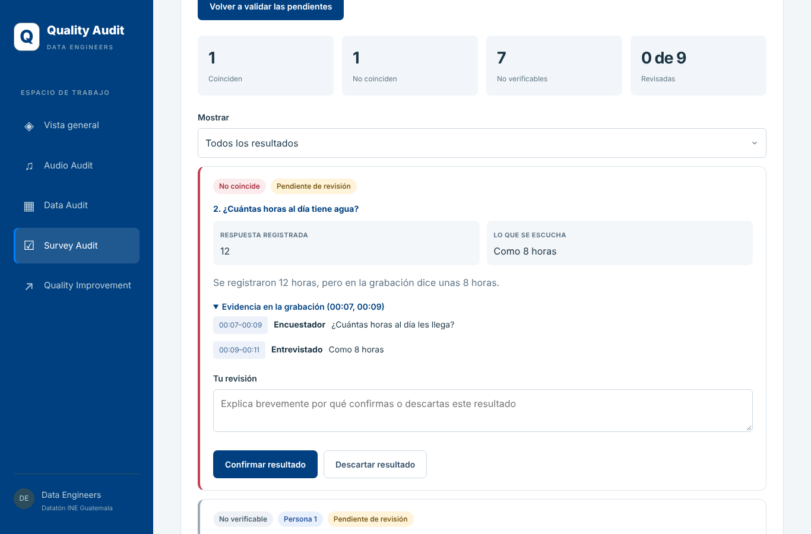

---

## 6. Quality Improvement: recomendaciones y manual institucional

**Ejemplo para practicar:** el reporte JSON descargado en el paso 3.2.

### 6.1 Generar recomendaciones

1. Ir a **Quality Improvement**, seleccionar el **Reporte de Data Audit (.json)** y pulsar **Generar recomendaciones**.
2. Se agrupan los hallazgos por institución, base, período y regla, ordenados por prioridad. Cada recomendación explica **qué ocurrió** (con cifras reales), **por qué es un problema**, **cómo corregirlo**, **cómo prevenirlo** y **acciones de mejora**, con la evidencia de la auditoría.
3. **Editar** si hace falta, y **Aprobar** escribiendo el cargo de quien aprueba; o **Descartar**. Si se vuelve a subir un reporte del mismo período, se actualiza la evidencia sin duplicar recomendaciones.

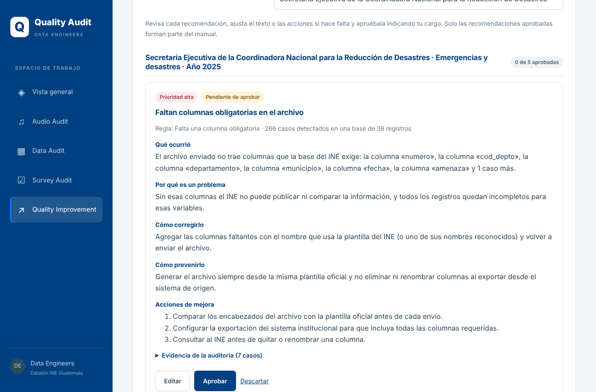

### 6.2 Crear el manual institucional

1. En **Manual institucional**, pulsar **Crear manual**: reúne las recomendaciones aprobadas de la institución.
2. Editar destinatario, introducción y secciones; **Guardar cambios**.
3. **Ver PDF** o **Descargar PDF**. Mientras es borrador, el PDF lleva el sello «BORRADOR».
4. **Finalizar manual** con el cargo de quien lo autoriza. Un manual final ya no se edita; una nueva versión se crea con otro manual.

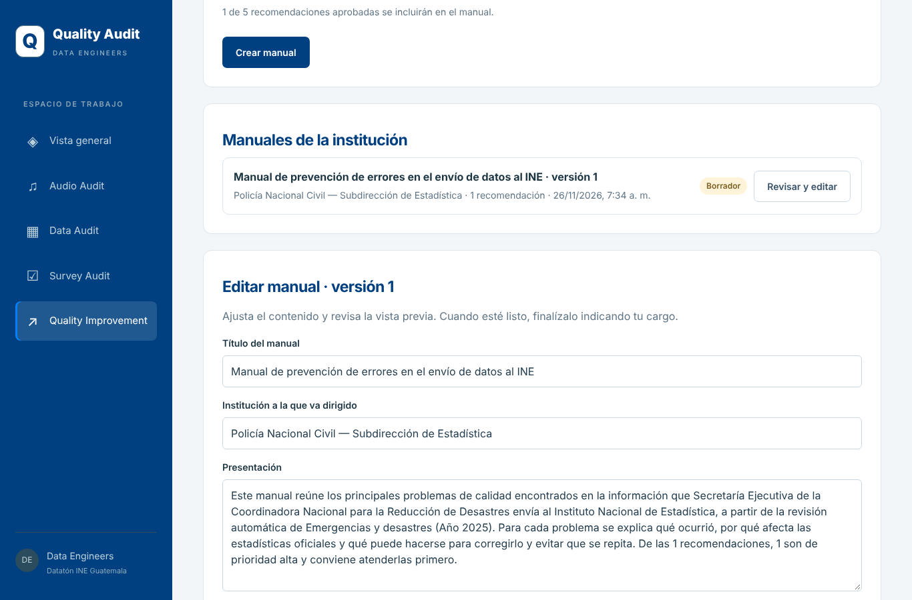
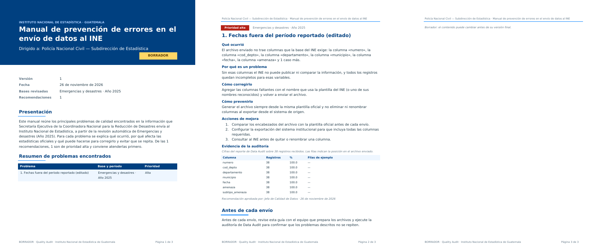

---

## 7. Preguntas frecuentes

| Situación | Qué hacer |
|---|---|
| «No se reconoce la institución de este reporte» | Elegir la institución en Quality Improvement y volver a subir el reporte. |
| Una base no aparece en la lista | El administrador debe cargar su configuración (ver [instalación](installation.md#42-cargar-reglas-y-catálogos-del-ine)). |
| «El archivo supera el límite» | Dividir el archivo (máximo 50 MB). |
| La lectura del PDF parece detenida | Esperar: si el servicio de IA está ocupado, la plataforma reintenta sola. Se puede continuar después. |
| «Primero vincula la transcripción» | Hacer el paso 5.3.1 antes de validar. |
| «Falta la llave OPENROUTER_API_KEY» al evaluar | El administrador debe configurar JEV en el servidor. |
| Se aprobó una corrección por error | Data Audit → **Correcciones guardadas** → quitarla y volver a validar la base. |
